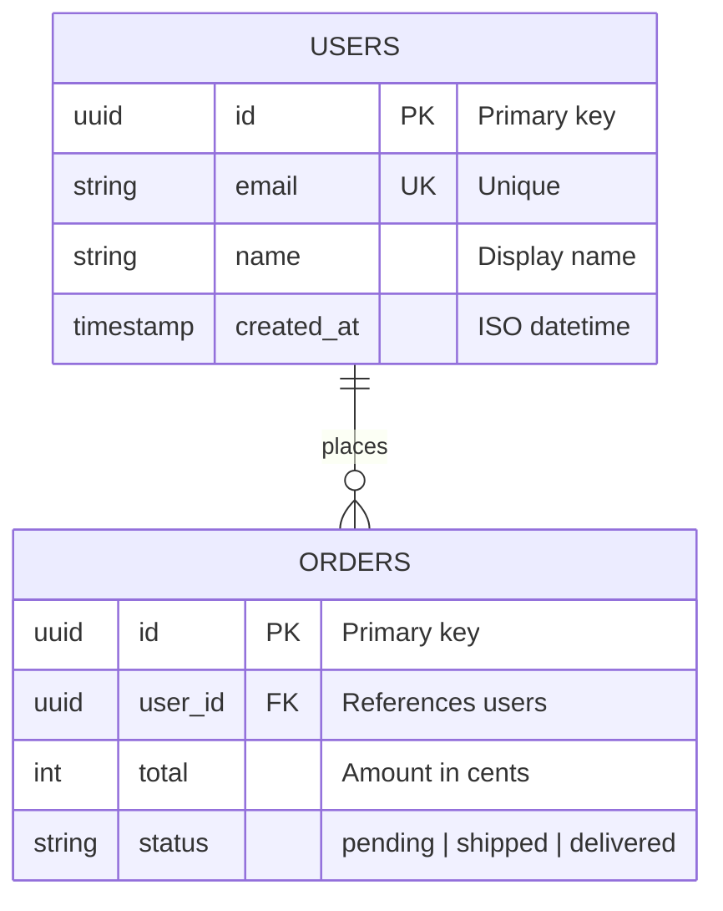
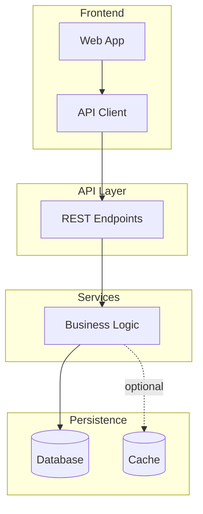
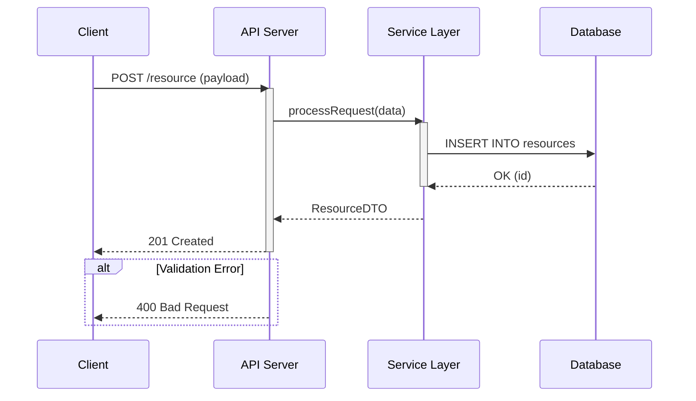
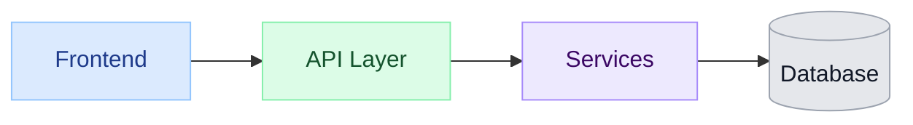

# Mermaid Syntax Cheat Sheet

Compact reference for architecture-diagrams.

## ER Diagrams
- Start with `erDiagram`.
- Entity syntax:
```mermaid
ENTITY {
  type name "comment"
}
```
- Common attribute types: `string`, `int`, `long`, `date`, `datetime`, `boolean`
- Key markers: `PK`, `FK`
- Relationship cardinality:
  - `||--||` one-to-one
  - `||--o{` one-to-many
  - `}o--o{` many-to-many
  - `o|` zero or one

Example:


## Flowcharts
- Layout directions: `flowchart TD` (top-down), `flowchart LR` (left-right)
- Node shapes:
  - `[text]` rectangle
  - `(text)` rounded
  - `{text}` decision/diamond
  - `[(text)]` database cylinder
- Arrows: `-->` solid, `-.->` dotted, `==>` thick
- Arrow label syntax: `-->|label|`
- Subgraph block:
```mermaid
subgraph Layer Name
  A --> B
end
```

Example (layered architecture):


## Sequence Diagrams
- Start with `sequenceDiagram`
- Participant alias syntax:
```mermaid
participant C as Component
```
- Arrows: `->>` sync call, `-->>` response, `--)` async
- Call stack focus: `activate`, `deactivate`
- Conditions: `alt`, `else`, `end`
- Notes: `Note over A,B: text`
- Highlight section: `rect rgb(...)` ... `end`

Example (generic API request flow):


## Styling
- Class definition:
```mermaid
classDef className fill:#color,stroke:#color,color:#fontcolor
```
- Assign class to node:
```mermaid
class nodeId className
```
- Suggested layer palettes:
  - Frontend/UI: blue (`#dbeafe`, `#93c5fd`, `#1e3a8a`)
  - API: green (`#dcfce7`, `#86efac`, `#14532d`)
  - Services: purple (`#ede9fe`, `#a78bfa`, `#3b0764`)
  - External APIs: amber (`#fef3c7`, `#fbbf24`, `#78350f`)
  - Persistence/DB: gray (`#e5e7eb`, `#9ca3af`, `#111827`)

Example styling:

