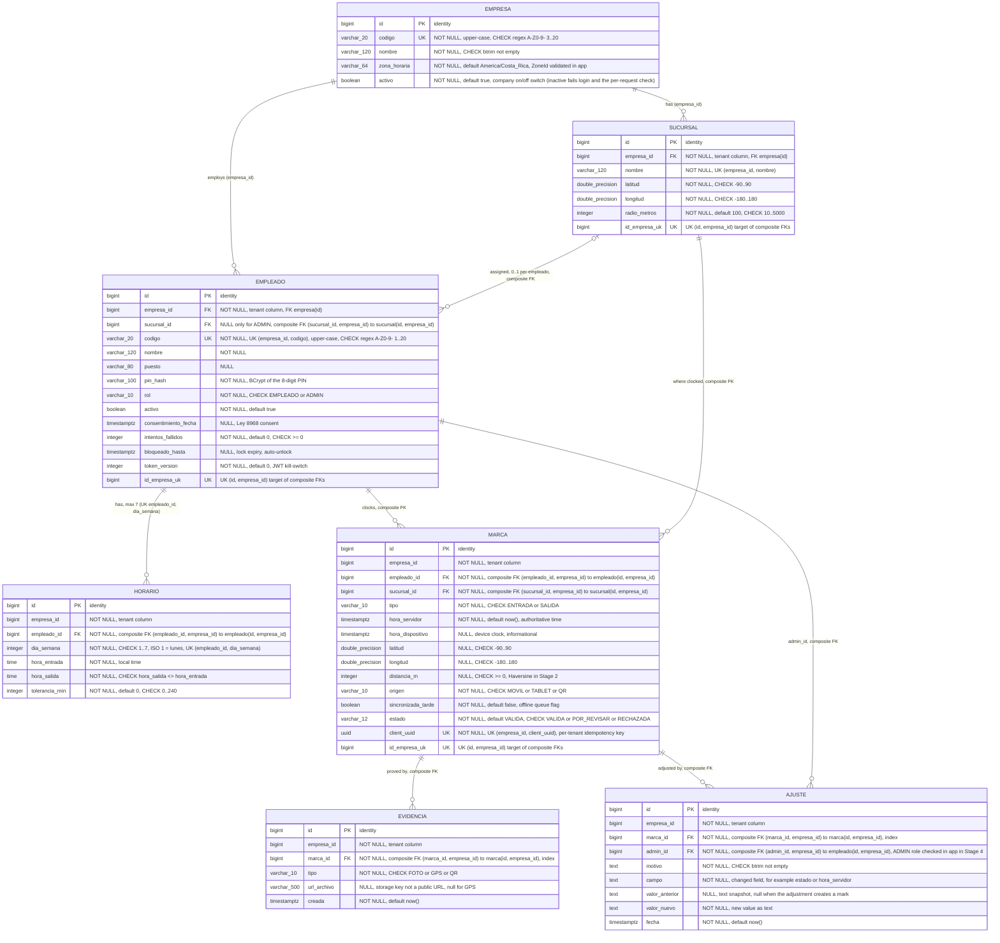
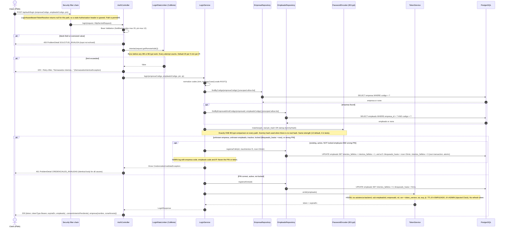
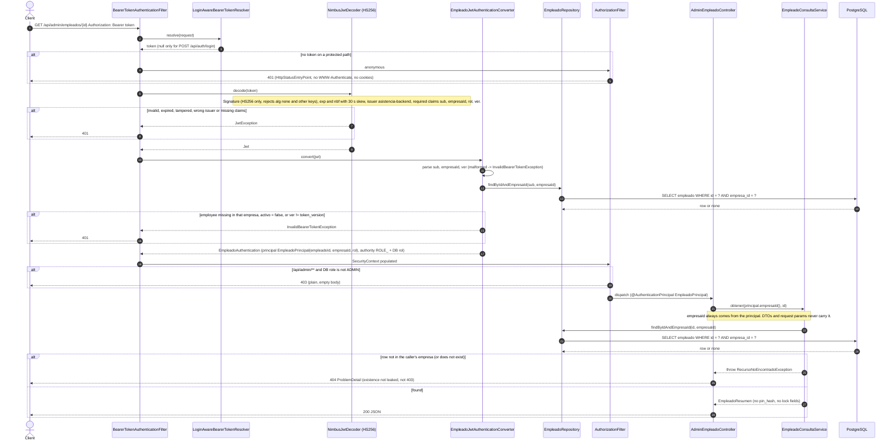
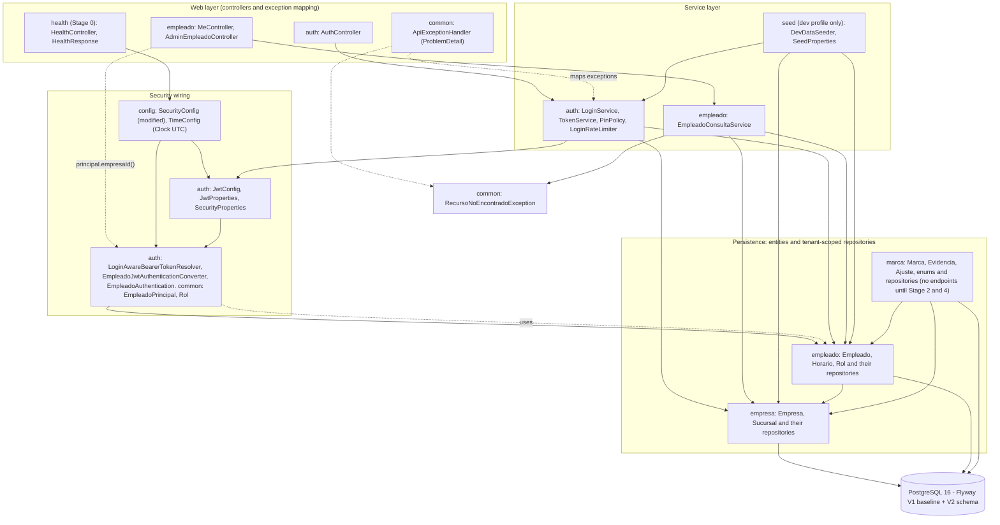

# Stage 1 - Data model and authentication diagrams

Source of truth: `docs/plans/stage-1-data-model-auth.md` (open questions resolved 2026-10-21). The Stage 1 code is implemented; the ER section matches the final migration (amendments 3, 4 and 5 applied). Existing Stage 0 code was checked for the base: `config/SecurityConfig`, `config/TimeConfig` (UTC `Clock` bean), `health/*`, Flyway `V1__baseline.sql` (empty baseline). Refresh these diagrams after the coder finishes.

Contents:
1. ER diagram (migration `V2__initial_schema.sql`)
2. Sequence: `POST /api/auth/login`
3. Sequence: authenticated request
4. Package/layer diagram of `cr.asistencia`
5. Plan-versus-code notes

---

## 1. ER diagram (V2 migration)

Seven tables. Conventions: `id` is `bigint GENERATED BY DEFAULT AS IDENTITY`, every instant is `timestamptz`, enums are `varchar` plus a `CHECK`, every FK is `ON DELETE RESTRICT`.

Mermaid cannot draw a composite FK, so it is shown as follows. Each child table has its own `empresa_id` column. The parent id column (for example `empleado_id`) is marked `FK`. The comment on that column says `composite FK (x_id, empresa_id)`. `UK` marks a single-column or composite unique constraint, and the comment names the columns. Every `UNIQUE (id, empresa_id)` is the target of the composite FKs.

Indexes (not drawn):
- `empleado (empresa_id, activo)`
- `marca (empresa_id, hora_servidor)`
- `marca (empleado_id, hora_servidor)`
- partial `marca (empresa_id) WHERE estado = 'POR_REVISAR'`
- `evidencia (marca_id)`
- `ajuste (marca_id)`

Notes: the `id_empresa_uk` rows are a drawing device for the composite `UNIQUE (id, empresa_id)` constraint. They are not real columns. `horario`, `evidencia` and `ajuste` have no `UNIQUE (id, empresa_id)` because nothing references them.

Key rules shown:
- **Tenant isolation, layer 1 (database).** Every tenant table carries `empresa_id`. Composite FKs `(x_id, empresa_id)` make cross-tenant links impossible (for example, an empleado of empresa A cannot point to a sucursal of B, and an ajuste cannot use an admin of another empresa). `horario`, `marca`, `evidencia` and `ajuste` have no direct FK to `empresa`. Their tenant is anchored through the composite FK to the parent.
- **No hard deletes.** `ON DELETE RESTRICT` everywhere. Attendance data is legal evidence, so use `activo = false`.
- **Lockout state** lives on `empleado` (`intentos_fallidos`, `bloqueado_hasta`). `token_version` invalidates issued JWTs (PIN reset, forced logout).
- **Roles.** `rol` is `EMPLEADO` or `ADMIN`. The CHECK `rol = 'ADMIN' OR sucursal_id IS NOT NULL` lets only an ADMIN have no sucursal.
- **Codes** are stored upper-case and checked by regex. The login identifiers are `empresa.codigo` plus `(empresa_id, empleado.codigo)`.
- **Idempotency.** `UNIQUE (empresa_id, client_uuid)` on `marca` makes the key per tenant, so an offline retry cannot create a duplicate mark.
- **Company switch.** `empresa.activo = false` makes login fail and the per-request re-check return 401.
- **Audit row.** `ajuste` records `campo`, `valor_anterior` (nullable, so an adjustment can create a mark) and `valor_nuevo`.
- **Where the PIN is stored.** Only `pin_hash` (BCrypt). The PIN is exactly 8 digits and is validated by `PinPolicy`, not by the database.

---

## 2. Sequence: `POST /api/auth/login`

Every failure path is one generic 401 (`codigo: CREDENCIALES_INVALIDAS`) and runs exactly one BCrypt `matches`. The only other outcomes are 400 (blank or oversized input) and 429 (IP limiter). The lockout counter is updated by an atomic `@Modifying` query in its own transaction, so it commits even though the request ends with 401. `LoginService` itself is not `@Transactional`.

Key rules shown:
- **No enumeration.** The status, body and BCrypt work are identical for unknown empresa, unknown empleado, inactive, locked and wrong PIN. A locked account with the correct PIN also gets the same 401.
- **Lockout.** 5 consecutive failures lock the account for 15 minutes (auto-unlock). A success resets the counter. The counter changes only for an existing, active, not-locked employee with a wrong PIN. The increment is a single atomic SQL update.
- **Two brute-force layers.** The per-IP limiter (429) runs first. The per-account lockout runs second.
- **PIN.** Exactly 8 digits. The login endpoint does not validate the format (no 400 for a bad format): a malformed PIN is just a counted wrong PIN. `PinPolicy` is enforced when PINs are set (seeder now, admin CRUD in Stage 4).
- **Token lifetime.** 8 h EMPLEADO, 6 h ADMIN, signed HS256 with `JWT_SECRET` (base64, at least 32 bytes, fail-fast at startup).
- **IP source.** `getRemoteAddr()` only. `X-Forwarded-For` is not trusted until Stage 5.

---

## 3. Sequence: authenticated request

Example: `GET /api/admin/empleados/{id}`. The same filter and converter apply to every non-public `/api/**` route. The role comes from the database, not from the `rol` claim.

Key rules shown:
- **Per-request DB re-check.** Each request verifies the employee exists in the token's empresa, is `activo` and has `ver == token_version`. Deactivation, PIN reset (which bumps `token_version`) and demotion take effect immediately, even on an unexpired token.
- **Tenant isolation, layers 2 and 3.** The controller takes `empresaId` from the authenticated principal. Tenant-owned repositories expose only `empresaId`-scoped methods (they extend the bare `Repository<T, Long>`). Another tenant's id returns 404, not 403.
- **401 versus 403.** 401 means no token, a bad token, or a stale or disabled employee. 403 means authenticated but the DB role is insufficient. Neither adds a `WWW-Authenticate` header or cookies.
- **Token lifetime.** The decoder rejects tokens past `exp` (8 h EMPLEADO, 6 h ADMIN, plus 30 s skew). There is no refresh. The client must ask for the PIN again.

---

## 4. Layer/package diagram of `cr.asistencia`

Arrows point from the depending package to the package it uses. Nodes marked (new) do not exist yet. `config` and `health` exist from Stage 0.

Dependency summary:

| Package | Depends on | Notes |
|---|---|---|
| `config` | `auth` (converter, resolver, properties) | Wires the filter chain. Also provides the shared `Clock`. |
| `common` | none (leaf) | `ApiExceptionHandler` maps `auth` exceptions to ProblemDetail. Exceptions are shared. |
| `auth` | `empresa`, `empleado`, `common`, `config` (Clock) | Owns login, JWT, PIN policy and the limiter. |
| `empresa` | none (tenant root) | `Empresa`, `Sucursal`. |
| `empleado` | `empresa`, `common` (principal, `Rol`) | `Horario` belongs here. No dependency on `auth`. |
| `marca` | `empleado`, `empresa` | Entities only in Stage 1. |
| `seed` | `auth` (`PinPolicy`), `empresa`, `empleado` | Active only under `dev`. Aborts if `prod` is active. |
| `health` | `config` (Clock) | Unchanged from Stage 0. |

Key rules shown:
- **Tenant isolation.** Only `auth` (login) may call the two unscoped lookups (`EmpresaRepository.findByCodigo`, `EmpleadoRepository.findByEmpresaIdAndCodigo`). Everything else receives `empresaId` from `EmpleadoPrincipal`.
- **Token lifetime and credentials.** `JwtProperties` (secret, issuer, TTL 8 h / 6 h, skew) and `SecurityProperties` (BCrypt strength, lockout 5 x 15 min, limiter 20 per 5 min) configure `auth`. The 8-digit PIN rule lives only in `auth.PinPolicy`, used by `seed` now and by admin CRUD in Stage 4.
- **No package cycle.** `EmpleadoPrincipal` and `Rol` live in `common` (plan amendment 6), so `empleado` doesn't depend on `auth`, while `auth` uses `empleado.EmpleadoRepository`.
- **`marca`** has no controllers or services yet. Stage 2 adds the check-in API.

---

## 5. Plan versus code notes

- **`SecurityConfig` comment and matchers.** The Stage 0 code has a comment "JWT filter is added here in Stage 1" (to be replaced). It also uses `requestMatchers(HttpMethod.GET, ...)`, but the plan's forward-compatibility rule says "`requestMatchers(String...)` only". The `HttpMethod` overload still exists in Security 7, so this is probably fine. The plan should state that explicitly.
- **`UserDetailsServiceAutoConfiguration`.** `AsistenciaApplication` already excludes it, which matches the plan's Boot 4 migration note.
- **`application.yml`.** The Stage 0 file has no `app.*` keys and no `spring.mvc.problemdetails`. These are Step 1 changes in the plan, not conflicts.
- **`V1__baseline.sql`** is a no-op (`SELECT 1;`), as the plan says. V2 holds the real schema.
