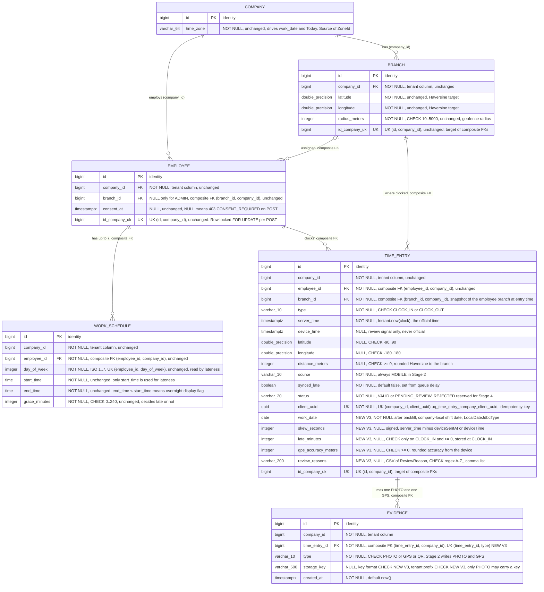
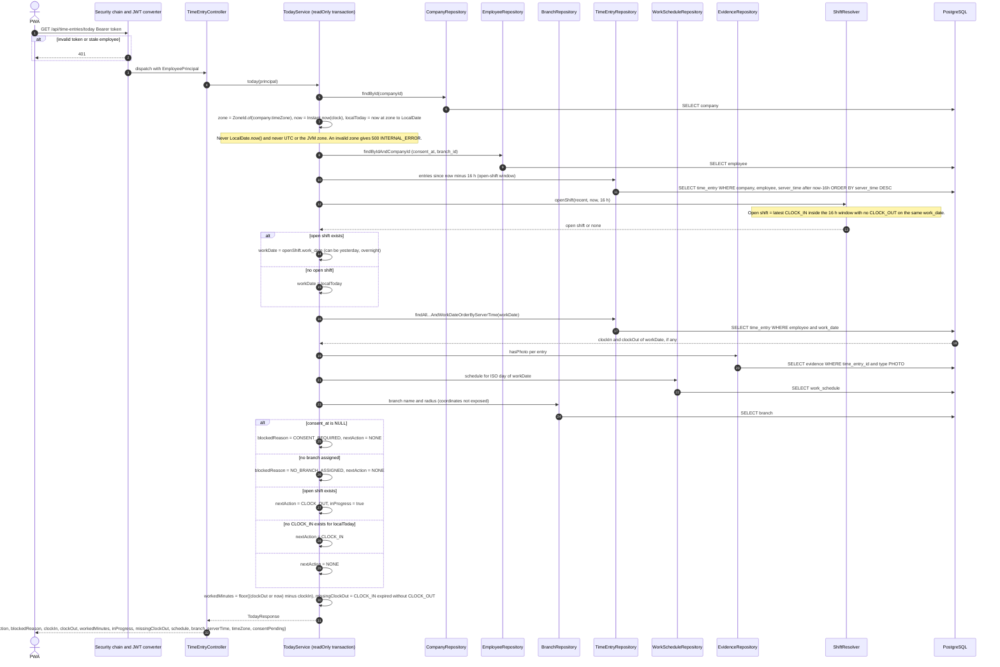
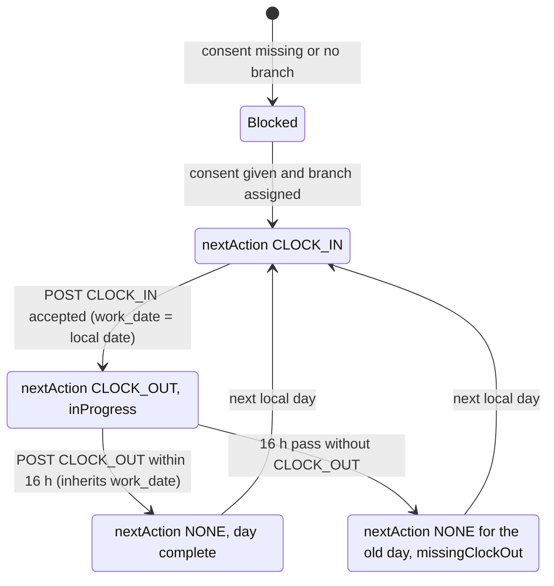
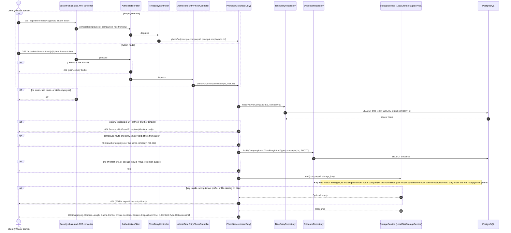
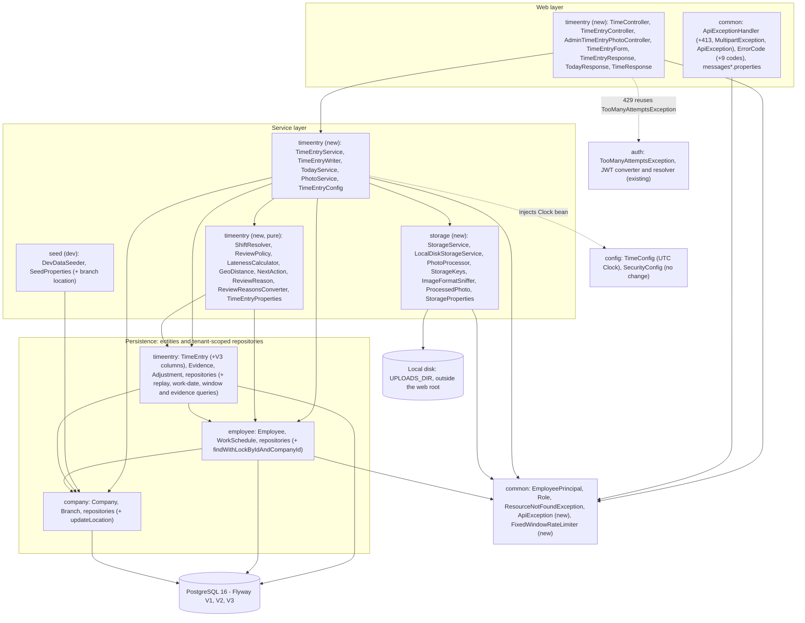

# Stage 2 - Check-in / time-entry API diagrams

Source of truth: `docs/plans/stage-2-time-entry-api.md`, including its last section "Open Questions: RESOLVED (2026-10-22, user)", which overrides earlier text (selfie REQUIRED, no `NO_PHOTO` reason, replay lookup before the photo check). The Stage 2 code does not exist yet, so everything marked (new) is drawn from the plan. The Stage 1 base was checked against the real code under `backend/src/main/java/cr/attendance/` and against `docs/diagrams/stage-1-er.md` and `V2__initial_schema.sql`.

> **Amendments after architect review (2026-10-22), applied in the code:**
> 1. The per-employee rate limit is a `HandlerInterceptor` (`TimeEntryRateLimitInterceptor`) that runs after authentication and before form binding and validation, so malformed posts also count and get 429 first. In the sequence below, the rate-limit step therefore comes before "bind TimeEntryForm".
> 2. `TooManyAttemptsException`, `InvalidCredentialsException` and `InvalidPinException` live in `common`; `common` imports no feature package, so the `common <-> auth` cycle noted in section 5 is gone.
> 3. Order after the replay lookup: photo present (400 `PHOTO_REQUIRED`), then a read-only consent and branch pre-check (403) in `TimeEntryService`, and only then photo decode and re-encode. The checks repeat inside the transaction under the employee lock. A request with no consent and an invalid photo gets 403 `CONSENT_REQUIRED`.
> 5. No stuck state from the 16 h rule: a CLOCK_OUT for an unclosed CLOCK_IN is always accepted; past the window it is saved as `PENDING_REVIEW` with `SHIFT_TOO_LONG`. A stale CLOCK_IN of an earlier work date is "forgotten": it no longer blocks a new CLOCK_IN, and `today` reports it as `forgottenWorkDate` / `missingClockOut`. A stale CLOCK_IN of the current local day stays open (`nextAction` CLOCK_OUT). New `ReviewReason`: `SHIFT_TOO_LONG`. The sequence rules look back `max(3 x max-shift-duration, 48 h)`.

Contents:
1. ER delta from `V3__time_entry_checkin.sql`
2. Sequence: `POST /api/time-entries`
3. Sequence: `GET /api/time-entries/today` (plus the button state diagram)
4. Sequence: authenticated photo download (employee and admin)
5. Package/layer diagram (`storage` and the `timeentry` additions)

---

## 1. ER delta (V3 migration)

Only `time_entry` and `evidence` change. `branch` and `work_schedule` get no DDL change in V3. They are drawn because Stage 2 reads them (geofence from `branch`, lateness from `work_schedule`). `employee` and `company` are reduced to the columns Stage 2 touches. For the full Stage 1 schema see `docs/diagrams/stage-1-er.md`.

Conventions are the same as in Stage 1. A composite FK `(x_id, company_id)` is shown on the `x_id` column with `FK` and a comment. `UK` marks a unique constraint or unique index, and the comment names the columns. Columns tagged `NEW V3` are added by the migration. `id_company_uk` is a drawing device for `UNIQUE (id, company_id)`, not a real column. Tenant composite FKs are all from V2. V3 adds none.

New constraints and indexes (V3):

| Object | On | Rule |
|---|---|---|
| `work_date SET NOT NULL` | `time_entry` | Backfilled first from `server_time AT TIME ZONE company.time_zone` |
| `ck_time_entry_location_pair` | `time_entry` | `(latitude IS NULL) = (longitude IS NULL)` |
| `ck_time_entry_late_minutes` | `time_entry` | `late_minutes IS NULL OR (type = 'CLOCK_IN' AND late_minutes >= 0)` |
| `ck_time_entry_gps_accuracy` | `time_entry` | `gps_accuracy_meters >= 0` |
| `ck_time_entry_review_reasons` | `time_entry` | `review_reasons ~ '^[A-Z_]+(,[A-Z_]+)*$'` |
| `uq_time_entry_employee_work_date_type` | `time_entry` | Unique **index** `(employee_id, work_date, type)`: one CLOCK_IN and one CLOCK_OUT per employee per work date |
| `ix_time_entry_company_work_date` | `time_entry` | Index `(company_id, work_date)` for the Stage 4 dashboard |
| `uq_evidence_time_entry_type` | `evidence` | `UNIQUE (time_entry_id, type)` |
| `ck_evidence_storage_key_type` | `evidence` | `type = 'PHOTO' OR storage_key IS NULL` |
| `ck_evidence_storage_key_format` | `evidence` | Key matches `^[0-9]+/[0-9]{4}-[0-9]{2}/[0-9a-f-]{36}\.jpg$` |
| `ck_evidence_storage_key_company` | `evidence` | `storage_key IS NULL OR split_part(storage_key, '/', 1) = company_id::text` |

Key rules shown:
- **One pair per work date.** The unique index is the database backstop for the application lock and the sequence rules. It includes REJECTED rows, because Stage 4 corrects entries through `adjustment`, not by re-clocking. It is an index, not a constraint, so it is absent from `pg_constraint`, but a violation reports its name.
- **`work_date` is computed in the app** from `company.time_zone`, never from UTC or the JVM zone. A shift belongs to the date its CLOCK_IN started, and a CLOCK_OUT inherits it (overnight rule).
- **Constraint count:** 37 in V2 plus 4 on `time_entry` plus 4 on `evidence` gives 45. `ix_*` indexes go from 6 to 7.
- **Tenant isolation is unchanged.** All composite FKs come from V2. V3 adds a second tenant guard at the data level: the key prefix of an `evidence.storage_key` must equal the row's `company_id`.
- **Nullable PHOTO key** is allowed on purpose: the Stage 5 retention job deletes old files and sets the key to NULL. The `time_entry` row is a legal record and stays.
- **GPS evidence** has a NULL key. The coordinates live on `time_entry`. No GPS evidence row exists when the device sent no location.

---

## 2. Sequence: `POST /api/time-entries`

Multipart request. `server_time` is always `Instant.now(clock)`. Checks run in the plan's fixed order, and the first failure wins. Every failure writes no row, no evidence and no file. `TimeEntryService` is deliberately **not** transactional. It does the cheap replay lookup and the CPU-heavy photo work outside any lock, then calls `TimeEntryWriter`, the only transactional class.

```mermaid
sequenceDiagram
    autonumber
    actor C as PWA
    participant SEC as Security chain and JWT converter
    participant CT as TimeEntryController
    participant RL as FixedWindowRateLimiter
    participant SV as TimeEntryService (not transactional)
    participant TR as TimeEntryRepository
    participant PP as PhotoProcessor
    participant WR as TimeEntryWriter (transactional)
    participant ER as EmployeeRepository
    participant BR as BranchRepository
    participant WS as WorkScheduleRepository
    participant RU as Rules (ShiftResolver, GeoDistance, ReviewPolicy, LatenessCalculator)
    participant ST as StorageService (disk)
    participant EV as EvidenceRepository
    participant DB as PostgreSQL

    C->>SEC: POST /api/time-entries multipart (type, clientUuid, deviceTime, lat, lng, accuracy, deviceSentAt, photo)
    SEC->>DB: SELECT employee WHERE id and company_id (per-request re-check)
    alt token missing, invalid, or employee inactive or stale ver
        SEC-->>C: 401
    end
    SEC->>CT: dispatch with EmployeePrincipal(employeeId, companyId, role)
    Note over CT: consumes multipart/form-data only, a JSON body gets 415

    CT->>RL: tryAcquire(companyId:employeeId)
    alt more than 30 attempts in 10 min (replays count)
        RL-->>C: 429 TOO_MANY_ATTEMPTS + Retry-After
    end

    CT->>CT: bind TimeEntryForm and Bean Validation (type, nil uuid, instants in 2000-2100, lat/lng pair and range, accuracy)
    alt malformed or missing field, comma decimal, NaN, MultipartException
        CT-->>C: 400 INVALID_REQUEST (value not echoed)
    end
    CT->>SV: record(principal, form, photo part)

    SV->>TR: findByCompanyIdAndClientUuid(companyId, clientUuid)
    TR->>DB: SELECT time_entry WHERE company_id and client_uuid
    DB-->>TR: row or none
    alt row found, same employee AND same type
        Note over SV: Replay. Runs before PHOTO_REQUIRED and before the sequence rules. Other fields and the photo are ignored, first write wins.
        SV->>EV: findByCompanyIdAndTimeEntryIdAndType(PHOTO)
        SV-->>C: 200 original entry, replayed true, hasPhoto true (no new row, no new file)
    else row found, other employee OR other type
        SV-->>C: 409 CLIENT_UUID_CONFLICT (no data of the first entry)
    end

    alt photo part absent
        SV-->>C: 400 PHOTO_REQUIRED (even if consent is also missing)
    end

    SV->>PP: process(photo)
    Note over PP: Outside any lock. 1) size 0 gives INVALID_PHOTO, more than 2 MB gives 413. 2) magic bytes JPEG FF D8 FF or PNG only. 3) header dimensions 32..4096 px and max 16 MP, read before decoding. 4) decode. 5) white RGB canvas, long side max 1280. 6) write JPEG q 0.85 with no metadata, so EXIF and GPS are dropped.
    alt empty, wrong magic bytes, bad dimensions, undecodable
        PP-->>C: 400 INVALID_PHOTO
    else larger than app.storage.max-photo-bytes
        PP-->>C: 413 PAYLOAD_TOO_LARGE
    end
    PP-->>SV: ProcessedPhoto(jpeg, width, height)

    SV->>WR: record(principal, form, processedPhoto)
    activate WR
    WR->>ER: findWithLockByIdAndCompanyId (PESSIMISTIC_WRITE, 5 s lock timeout)
    ER->>DB: SELECT employee FOR UPDATE
    Note over WR,DB: Serializes every POST of this employee. A second same-key request waits here.
    WR->>TR: re-check findByCompanyIdAndClientUuid
    alt a concurrent request committed the same key
        WR-->>SV: replay (same employee and type) or CLIENT_UUID_CONFLICT
    end

    alt consent_at is NULL
        WR-->>C: 403 CONSENT_REQUIRED (nothing written)
    end
    alt employee has no branch (ADMIN only)
        WR-->>C: 403 NO_BRANCH_ASSIGNED
    end
    WR->>BR: findByIdAndCompanyId(branchId, companyId)
    BR->>DB: SELECT branch
    WR->>TR: recent entries since now minus 16 h (open-shift window)
    TR->>DB: SELECT time_entry WHERE employee and server_time after now-16h
    WR->>RU: ShiftResolver.check(type, openShift, localToday in company zone)
    alt CLOCK_IN with an open shift, or a CLOCK_IN already exists for the work date without CLOCK_OUT
        RU-->>C: 409 ALREADY_CLOCKED_IN
    else CLOCK_IN and the day already has CLOCK_IN and CLOCK_OUT
        RU-->>C: 409 SHIFT_ALREADY_COMPLETED
    else CLOCK_OUT without an open shift
        RU-->>C: 409 NOT_CLOCKED_IN
    end
    RU-->>WR: work_date (localToday for CLOCK_IN, open shift work_date for CLOCK_OUT)

    opt lat and lng sent
        WR->>RU: GeoDistance.meters(branch, point) (Haversine, R 6371008.8)
    end
    WR->>RU: ReviewPolicy.evaluate(distance, radius, accuracy, serverTime, deviceTime, deviceSentAt)
    Note over RU: Reasons are a set. NO_GPS, OUTSIDE_GEOFENCE, LOW_GPS_ACCURACY (above 100 m), SYNCED_LATE (queue delay or fallback above 2 min), DEVICE_CLOCK_AHEAD (skew below minus 2 min). Empty set gives VALID, otherwise PENDING_REVIEW. skew_seconds uses deviceSentAt when present and not earlier than deviceTime.
    RU-->>WR: ReviewOutcome(reasons, syncedLate, status, insideGeofence)

    opt type is CLOCK_IN
        WR->>WS: schedule for (employee, ISO day of work_date)
        WS->>DB: SELECT work_schedule
        WR->>RU: LatenessCalculator.lateMinutes(serverTime, workDate, zone, schedule)
        Note over RU: minutes since scheduled start. 0 if within grace. NULL when there is no schedule that day. Stored once, never recomputed on read.
    end

    WR->>ST: store(companyId, YearMonth of server_time in company zone, jpeg)
    Note over ST: key companyId/yyyy-MM/random-uuid.jpg. Temp file then ATOMIC_MOVE, never overwrites.
    alt disk full or I/O error
        ST-->>C: 500 INTERNAL_ERROR (transaction rolls back, no row)
    end
    ST-->>WR: storage key
    WR->>WR: register TransactionSynchronization, afterCompletion(ROLLED_BACK) deletes the key

    WR->>TR: save(TimeEntry) with work_date, skew, late_minutes, accuracy, reasons
    TR->>DB: INSERT time_entry
    WR->>EV: save PHOTO evidence (storage_key)
    EV->>DB: INSERT evidence
    opt lat and lng sent
        WR->>EV: save GPS evidence (storage_key NULL)
        EV->>DB: INSERT evidence
    end

    alt any insert or the commit fails
        DB-->>WR: error (for example unique violation)
        WR->>DB: ROLLBACK
        WR->>ST: afterCompletion(STATUS_ROLLED_BACK) then delete(key)
        Note over WR,ST: The orphan photo file is removed. If the JVM crashes between store and commit, the file stays as an orphan until the Stage 5 sweeper (evidence-less files older than 24 h).
        WR-->>SV: DataIntegrityViolationException
        alt constraint uq_time_entry_company_client_uuid
            SV->>TR: fresh lookup
            SV-->>C: 200 replay (same employee and type) or 409 CLIENT_UUID_CONFLICT
        else index uq_time_entry_employee_work_date_type
            SV-->>C: 409 ALREADY_CLOCKED_IN
        else other error
            SV-->>C: 500 INTERNAL_ERROR
        end
    else committed
        DB-->>WR: COMMIT (row lock released)
        deactivate WR
        WR-->>SV: TimeEntryResult(created)
        SV-->>C: 201 TimeEntryResponse (id, type, serverTime, workDate, status, reviewReasons, syncedLate, skewSeconds, distanceMeters, radiusMeters, insideGeofence, lateMinutes, hasPhoto, replayed false)
    end
```

Key rules shown:
- **Order of checks (first failure wins):** 401 token, 429 rate limit, 415/400 form, replay (200 or 409 `CLIENT_UUID_CONFLICT`), 400 `PHOTO_REQUIRED`, 413/400 photo, then inside the transaction 403 `CONSENT_REQUIRED`, 403 `NO_BRANCH_ASSIGNED`, 409 sequence codes. A request with no photo and no consent gets `PHOTO_REQUIRED`.
- **Replay is read-only and exact.** It needs the same `(company_id, client_uuid)`, the same employee and the same type. It returns the original entry with 200, with or without a photo part, and even after a later CLOCK_OUT exists. Another employee or another type gets 409 and never sees the original data.
- **Photo work is outside the lock and the transaction.** Only the bytes matter. The client filename and content type are never used. The stored file is always a re-encoded JPEG without EXIF.
- **The employee row lock** serializes all POSTs of one employee, so a double tap gives one row and one file. The two unique constraints are the backstop, mapped by constraint name outside the transaction.
- **Orphan file on failure.** The file is written before the inserts (inside the transaction). A rollback or failed commit triggers `afterCompletion(ROLLED_BACK)`, which deletes it. Only a process crash can leave an orphan.
- **`device_time` is never official.** It only adds review reasons. `work_date`, lateness and `server_time` all come from the server clock and the company zone.
- **No `NO_PHOTO` reason and no `REJECTED` status** in Stage 2.

---

## 3. Sequence: `GET /api/time-entries/today`

Read-only. It never reads the device clock or the JVM zone. "Today" is computed in the company time zone from the injected UTC `Clock`.

The single button follows this state machine:

Key rules shown:
- **Work date.** The open shift's `work_date` if one exists (so 00:30 after a 22:00 shift still shows the previous day's shift with `CLOCK_OUT`), otherwise the company-local date of now.
- **Open shift window** is 16 h by default (`app.time-entry.max-shift-duration`). After that the shift is no longer open, the day shows `missingClockOut`, and the next day's CLOCK_IN is allowed.
- **`blockedReason` wins.** When consent or branch is missing, `nextAction` is `NONE`. Today and time stay readable without consent, only the POST is refused.
- **Overnight edge.** After a Monday 22:00 to Tuesday 06:00 shift, Tuesday 07:00 shows `CLOCK_IN`, which is right for Tuesday 22:00. Stage 3 decides how to show "last shift done".
- **Tenant scoped.** Every query takes `companyId` from the principal. Another company's entries never appear.

---

## 4. Sequence: authenticated photo download

Two routes, one service. `PhotoService.photoFor(companyId, employeeIdOrNull, timeEntryId)` returns a `Resource` or throws `ResourceNotFoundException`. The employee route passes the caller's `employeeId`. The admin route passes `null`, so any entry of the admin's company is allowed. Every miss gives the same 404, so existence is never leaked.

Key rules shown:
- **Tenant isolation.** The lookup is scoped by the principal's `companyId`, and the storage layer checks the key prefix again. Another tenant gets 404, never 403 and never the bytes. The DB also enforces the same prefix (`ck_evidence_storage_key_company`).
- **Employee route is own-only.** Another employee's entry in the same company is 404. An employee calling the admin route gets 403 from the existing `/api/admin/**` rule.
- **No path from the client.** The id is numeric, and the storage key comes only from the `evidence` row. A non-numeric id gives 400 without echo.
- **Not cacheable and not public.** `Cache-Control: private, no-store`, served with `image/jpeg` always, because every stored file was re-encoded.

---

## 5. Package/layer diagram

Arrows point from the depending package to the package it uses. Nodes marked (new) do not exist yet. Solid arrows are compile-time dependencies. The dashed arrow marks the one coupling that deserves a decision (see the notes).

Dependency summary (new and changed rows):

| Package | Depends on | Notes |
|---|---|---|
| `storage` (new) | `common` only | `ApiException`/`ErrorCode` for `INVALID_PHOTO` and `PAYLOAD_TOO_LARGE`. Knows nothing about `timeentry`: its API takes `companyId`, `YearMonth` and bytes. |
| `timeentry` (extended) | `storage`, `employee`, `company`, `common`, (`auth` for one exception class) | Adds controllers, services and pure rules on top of the Stage 1 entities. Reads the shared `Clock` bean from `config` by injection. |
| `employee` | `company`, `common` | Only adds `findWithLockByIdAndCompanyId`. Does not depend on `timeentry`. |
| `company` | none | Only adds `updateLocation` for the dev seed. |
| `common` | `auth` (exceptions in `ApiExceptionHandler`) | Adds `ApiException` and `FixedWindowRateLimiter`. |
| `seed` | `company`, `employee`, `auth` (`PinPolicy`) | Applies optional branch coordinates through `updateLocation` (dev profile only). |

Key rules shown:
- **No new cycle.** The new edges are `timeentry -> storage -> common`, plus `timeentry -> employee/company/common`. `storage` never points back to `timeentry`, `employee` and `company` never point to `timeentry`, so the graph stays acyclic for these packages.
- **Pre-existing cycle to note.** `common.ApiExceptionHandler` already imports `auth` exceptions while `auth` imports `common` (`EmployeePrincipal`, `Role`). That `common <-> auth` package cycle exists in the Stage 1 code and is not removed or made worse by Stage 2. It becomes slightly more visible if `timeentry` imports `auth.TooManyAttemptsException`.
- **Storage is behind an interface.** `TimeEntryWriter` depends on `StorageService`, so a later S3 or similar implementation replaces `LocalDiskStorageService` without touching `timeentry`.
- **Tenant isolation holds.** Every new repository method takes `companyId`. `TimeEntryService`, `TodayService` and `PhotoService` receive it from `EmployeePrincipal` and never from request data. `StorageService.load` checks the key prefix again.
- **Pure rules are unit-testable** (`ShiftResolver`, `ReviewPolicy`, `LatenessCalculator`, `GeoDistance`): no Spring, no repositories, the `Clock` value is passed in.
