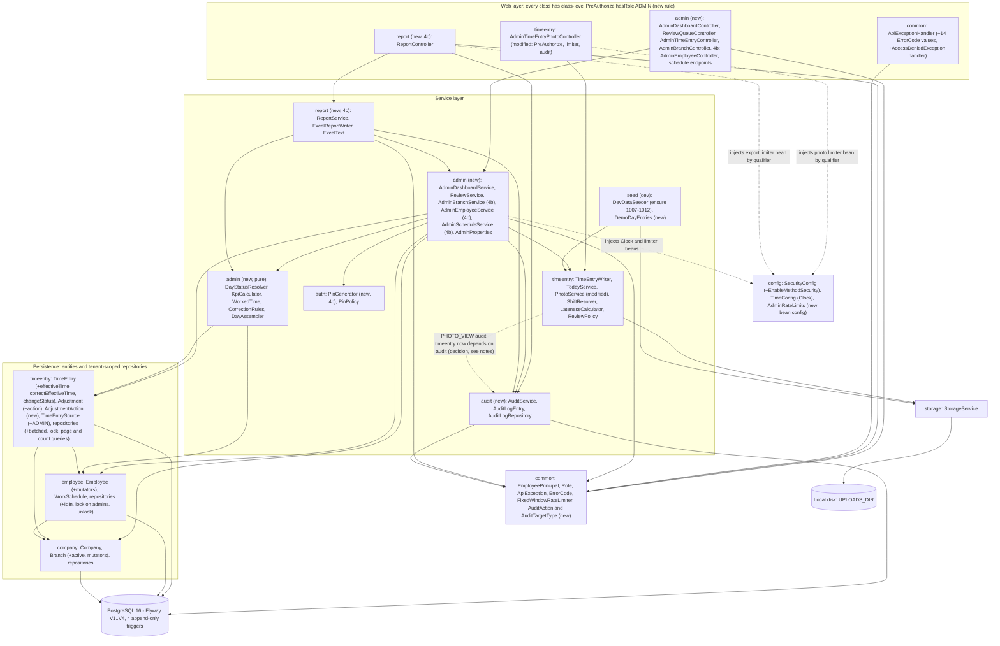
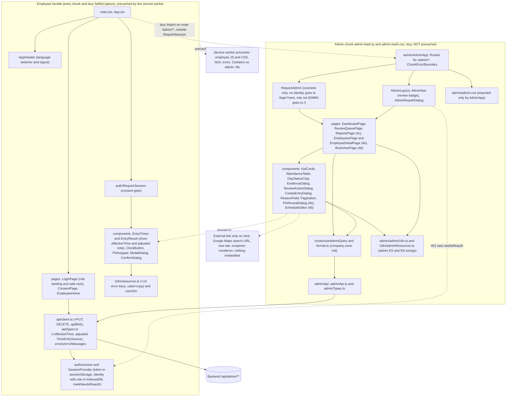
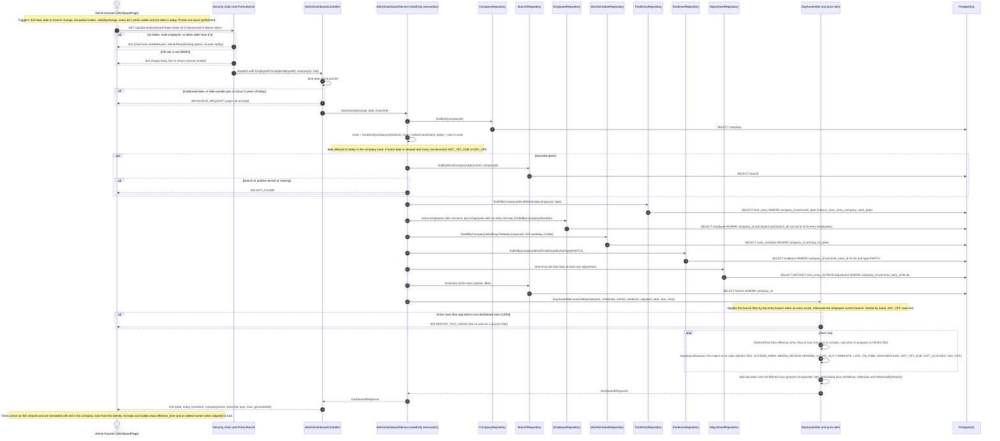
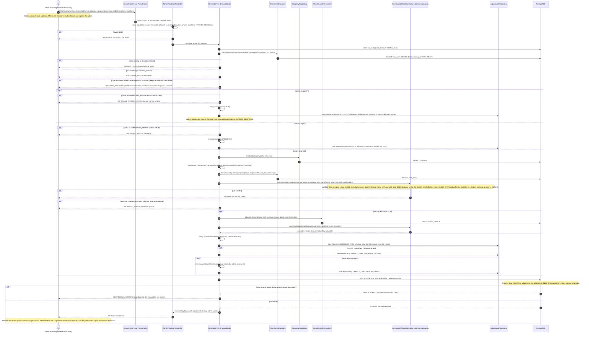
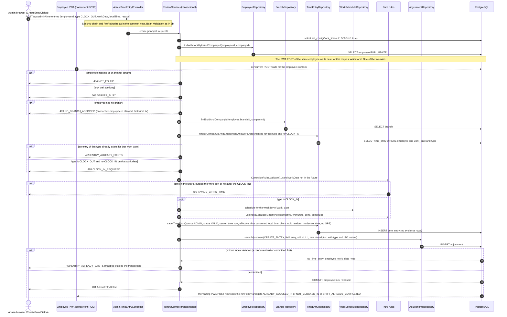
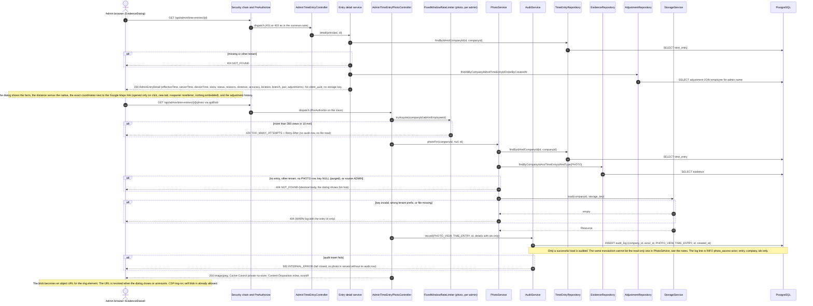
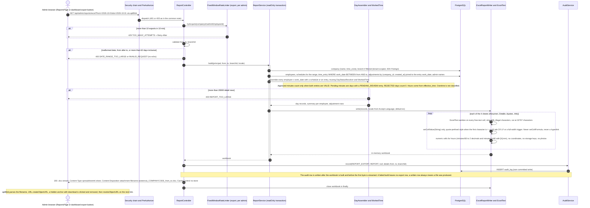
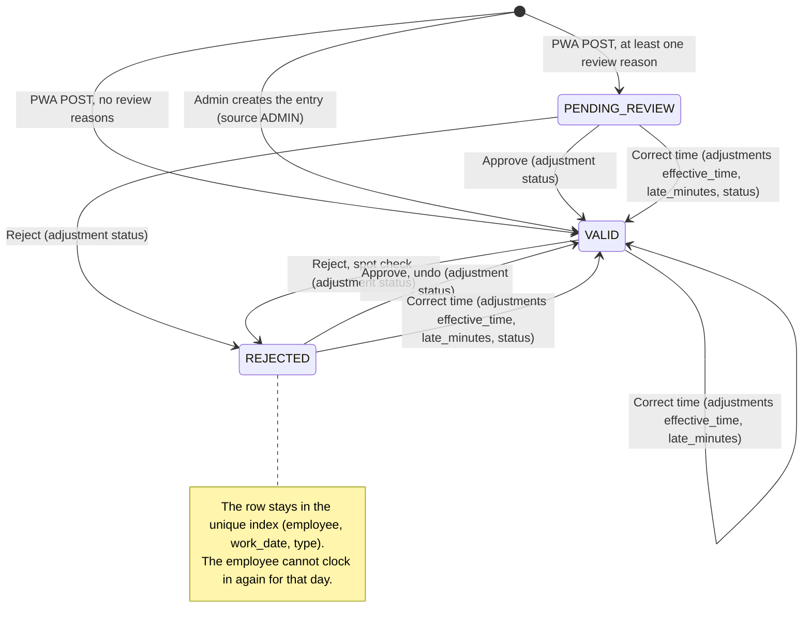
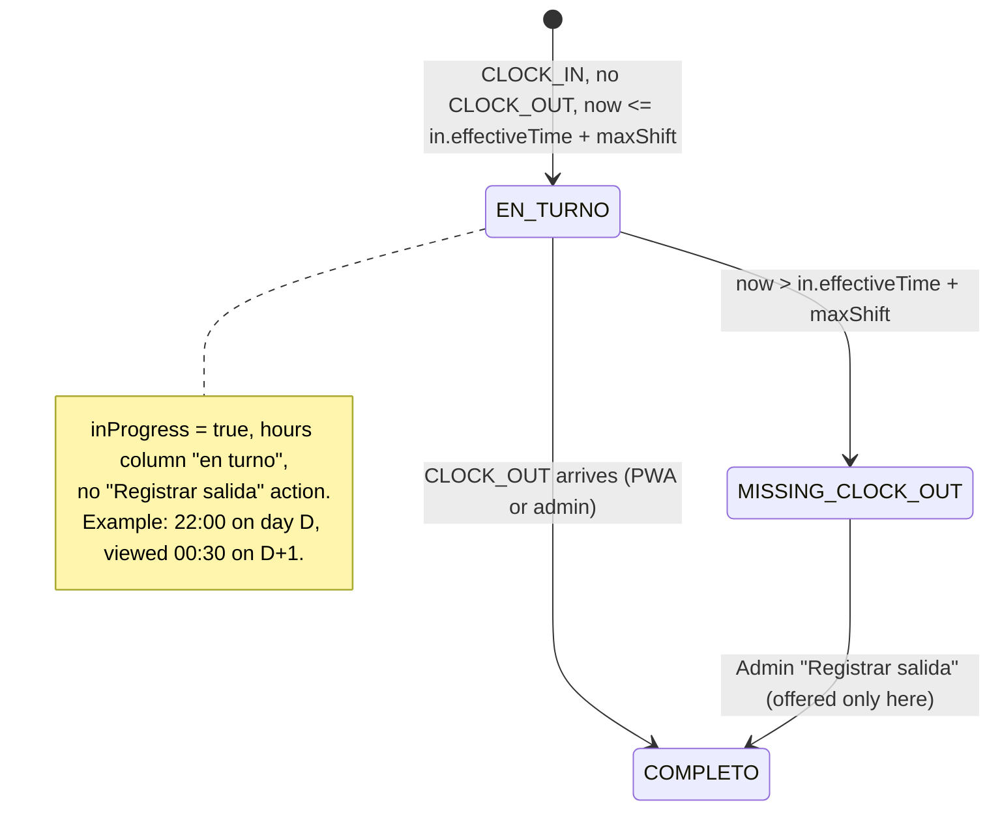

# Stage 4 - Admin panel diagrams

Source of truth: `docs/plans/stage-4-admin-panel.md`, including its last section "Open Questions: RESOLVED (2026-10-28, user)", which overrides earlier text (map link is **Google Maps**, not OpenStreetMap; register is "usted" everywhere; the other defaults are adopted, including the two extra review reasons and the opt-in demo day). The Stage 4 code does not exist yet, so everything marked (new) is drawn from the plan. The base was checked against the live code: `V1`..`V3` migrations, `cr.attendance.*` (config, common, auth, company, employee, timeentry, storage, seed), `SchemaEnglishNamingTest`, and `frontend/src/App.tsx`, `AppHeader.tsx`, `vite.config.ts`. Inconsistencies found are listed at the end under "Notes for the coder".

Previous diagrams: `stage-1-er.md` (full V2 schema) and `stage-2-time-entry.md` (V3 delta, POST sequence, package layers).

Contents:
1. ER diagram after V4
2. Layer diagrams: backend packages, frontend admin chunk versus employee bundle
3. Sequences: (a) dashboard load, (b) review approve / reject / correct, (b2) admin-created entry, (c) evidence view with photo audit and rate limit, (d) Excel export
4. State diagram: time entry status
5. Notes for the coder

---

## 1. ER diagram after V4

Eight tables. The plan has **no separate photo access log table**: a photo view is one `audit_log` row with `action = PHOTO_VIEW`, `target_type = TIME_ENTRY` and `target_id` = the entry id. Conventions are the same as in Stage 1 and 2. A composite FK `(x_id, company_id)` is shown on the `x_id` column with `FK` and a comment. `UK` marks a unique constraint or unique index, and the comment names the columns. `id_company_uk` is a drawing device for `UNIQUE (id, company_id)`, not a real column. Columns tagged `NEW V4` are added by the migration, and `CHANGED V4` marks a changed CHECK. Unchanged columns are kept where they matter for the Stage 4 rules. `evidence` and `work_schedule` are drawn in full-row form only where Stage 4 reads them, with no DDL change.

```mermaid
erDiagram
    COMPANY {
        bigint id PK "identity"
        varchar_20 code UK "NOT NULL, upper-case, unchanged"
        varchar_120 name "NOT NULL, unchanged, shown in the dashboard header"
        varchar_64 time_zone "NOT NULL, unchanged, converts every admin local date and time"
        boolean active "NOT NULL, unchanged"
    }

    BRANCH {
        bigint id PK "identity"
        bigint company_id FK "NOT NULL, tenant column, FK company(id)"
        varchar_120 name "NOT NULL, UK (company_id, name) uq_branch_company_name"
        double_precision latitude "NOT NULL, CHECK -90..90, unchanged"
        double_precision longitude "NOT NULL, CHECK -180..180, unchanged"
        integer radius_meters "NOT NULL, CHECK 10..5000, unchanged"
        boolean active "NEW V4, NOT NULL, default true, retire a branch without deleting history"
        bigint id_company_uk UK "UK (id, company_id), unchanged"
    }

    EMPLOYEE {
        bigint id PK "identity"
        bigint company_id FK "NOT NULL, tenant column, FK company(id)"
        bigint branch_id FK "NULL only for ADMIN, composite FK (branch_id, company_id), unchanged"
        varchar_20 code UK "NOT NULL, UK (company_id, code), immutable in the app"
        varchar_120 name "NOT NULL"
        varchar_80 job_title "NULL"
        varchar_100 pin_hash "NOT NULL, BCrypt, written by create and PIN reset in 4b"
        varchar_10 role "NOT NULL, CHECK EMPLOYEE or ADMIN, unchanged"
        boolean active "NOT NULL"
        timestamptz consent_at "NULL"
        integer failed_attempts "NOT NULL, cleared by unlock"
        timestamptz locked_until "NULL, cleared by unlock"
        integer token_version "NOT NULL, bumped by role change, deactivate, PIN reset"
        bigint id_company_uk UK "UK (id, company_id), target of the composite FKs. Locked FOR UPDATE by the PWA POST and by admin-created entries"
    }

    WORK_SCHEDULE {
        bigint id PK "identity"
        bigint company_id "NOT NULL, tenant column"
        bigint employee_id FK "NOT NULL, composite FK (employee_id, company_id)"
        integer day_of_week "NOT NULL, ISO 1..7, UK (employee_id, day_of_week)"
        time start_time "NOT NULL"
        time end_time "NOT NULL, CHECK end_time <> start_time"
        integer grace_minutes "NOT NULL, CHECK 0..240. No DDL change. 4b replaces the whole week, hard delete allowed (configuration, not evidence)"
    }

    TIME_ENTRY {
        bigint id PK "identity"
        bigint company_id "NOT NULL, tenant column"
        bigint employee_id FK "NOT NULL, composite FK (employee_id, company_id)"
        bigint branch_id FK "NOT NULL, composite FK (branch_id, company_id), branch of the employee at entry time"
        varchar_10 type "NOT NULL, CHECK CLOCK_IN or CLOCK_OUT"
        timestamptz server_time "NOT NULL, IMMUTABLE receipt time. Read by ShiftResolver, replay, photo month and skew"
        timestamptz effective_time "NEW V4, NOT NULL after backfill, equals server_time until an admin corrects it. Read by dashboard, review, export, worked time"
        timestamptz device_time "NULL, review signal only. NULL for source ADMIN"
        double_precision latitude "NULL, CHECK -90..90. NULL for source ADMIN"
        double_precision longitude "NULL, CHECK -180..180. NULL for source ADMIN"
        integer distance_meters "NULL, CHECK >= 0"
        varchar_10 source "NOT NULL, CHANGED V4 CHECK MOBILE or TABLET or QR or ADMIN"
        boolean synced_late "NOT NULL"
        varchar_20 status "NOT NULL, CHECK VALID or PENDING_REVIEW or REJECTED. REJECTED is first used in Stage 4"
        uuid client_uuid UK "NOT NULL, UK (company_id, client_uuid). Admin entries get a server-side random UUID. Never exposed in admin APIs"
        date work_date "NOT NULL, company-local shift date, NEVER changed by a correction"
        integer skew_seconds "NULL"
        integer late_minutes "NULL, CHECK only CLOCK_IN and >= 0. Recomputed from effective_time when a CLOCK_IN is corrected"
        integer gps_accuracy_meters "NULL, CHECK >= 0"
        varchar_200 review_reasons "NULL, CSV of ReviewReason, kept after approval. Empty set is stored as NULL, so admin entries pass the regex CHECK"
        bigint id_company_uk UK "UK (id, company_id). Index uq_time_entry_employee_work_date_type (employee_id, work_date, type) includes REJECTED rows"
    }

    EVIDENCE {
        bigint id PK "identity"
        bigint company_id "NOT NULL, tenant column"
        bigint time_entry_id FK "NOT NULL, composite FK (time_entry_id, company_id), UK (time_entry_id, type)"
        varchar_10 type "NOT NULL, PHOTO or GPS or QR. No DDL change. Admin-created entries have NO evidence rows"
        varchar_500 storage_key "NULL, tenant-prefix CHECK, never returned by any API"
        timestamptz created_at "NOT NULL"
    }

    ADJUSTMENT {
        bigint id PK "identity"
        bigint company_id "NOT NULL, tenant column"
        bigint time_entry_id FK "NOT NULL, composite FK (time_entry_id, company_id), index"
        bigint admin_id FK "NOT NULL, composite FK (admin_id, company_id), ADMIN role checked in the app. admin_id = employee of the entry means self-approved"
        varchar_20 action "NEW V4, NOT NULL, CHECK APPROVE or REJECT or CORRECT_TIME or CREATE_ENTRY"
        text reason "NOT NULL, CHECK btrim not empty, CHANGED V4 also CHECK char_length <= 500. The app requires 5..500"
        text field "NOT NULL, CHANGED V4 CHECK status or effective_time or late_minutes or entry"
        text old_value "NULL, plain text. NULL for CREATE_ENTRY"
        text new_value "NOT NULL, plain text, ISO instant with offset or status name or integer or entry description"
        timestamptz created_at "NOT NULL, one user action writes 1..3 rows with the same reason and created_at. New index (company_id, created_at)"
    }

    AUDIT_LOG {
        bigint id PK "NEW V4 table, identity"
        bigint company_id "NOT NULL, tenant column, no direct FK to company, anchored by the composite FK below"
        bigint actor_id FK "NOT NULL, composite FK (actor_id, company_id) to employee, fk_audit_log_actor_company"
        varchar_40 action "NOT NULL, CHECK regex ^[A-Z_]{3,40}$ so new AuditAction values need no migration"
        varchar_20 target_type "NOT NULL, CHECK TIME_ENTRY or EMPLOYEE or BRANCH or WORK_SCHEDULE or REPORT"
        bigint target_id "NULL, polymorphic by target_type, deliberately NO FK (REPORT has none)"
        varchar_500 details "NULL, ids and field names only. No PIN, no names, no coordinates"
        timestamptz created_at "NOT NULL, default now(). Index (company_id, created_at)"
    }

    COMPANY ||--o{ BRANCH : "has (company_id)"
    COMPANY ||--o{ EMPLOYEE : "employs (company_id)"
    BRANCH |o--o{ EMPLOYEE : "assigned, composite FK"
    EMPLOYEE ||--o{ WORK_SCHEDULE : "has up to 7, composite FK"
    EMPLOYEE ||--o{ TIME_ENTRY : "clocks, composite FK"
    BRANCH ||--o{ TIME_ENTRY : "where clocked, composite FK"
    TIME_ENTRY ||--o{ EVIDENCE : "max one PHOTO and one GPS, composite FK"
    TIME_ENTRY ||--o{ ADJUSTMENT : "adjusted by, composite FK, append-only"
    EMPLOYEE ||--o{ ADJUSTMENT : "admin_id, composite FK"
    EMPLOYEE ||--o{ AUDIT_LOG : "actor_id, composite FK, append-only"
```

### What V4 does, in order

| # | Statement | Why the order matters |
|---|---|---|
| 1 | `time_entry.effective_time` added as NULL, backfilled `= server_time`, then `SET NOT NULL` | Existing rows must be filled before the NOT NULL |
| 2 | `ck_time_entry_source` dropped and recreated with `ADMIN` | Name is the V2 name, so the constraint count does not change |
| 3 | `ix_time_entry_pending_review` dropped and recreated as `(company_id, work_date) WHERE status = 'PENDING_REVIEW'` | Review queue is one company, oldest work date first |
| 4 | `adjustment.action` added NULL, backfilled `CORRECT_TIME`, `SET NOT NULL`, then 3 new CHECKs and `ix_adjustment_company_created` | Backfill before NOT NULL and before the `field` CHECK |
| 5 | `branch.active boolean NOT NULL DEFAULT true` | Existing rows become active |
| 6 | `audit_log` table, `fk_audit_log_actor_company`, 2 CHECKs, `ix_audit_log_company_created` | New tenant table, tenant anchored by the composite FK |
| 7 | Function `forbid_audit_change()` and 4 triggers | Created **last**, after the backfill `UPDATE`s of steps 1 and 4, otherwise the migration would block itself |

### Append-only triggers

| Trigger | Table | Fires | Effect |
|---|---|---|---|
| `tr_adjustment_append_only` | `adjustment` | `BEFORE UPDATE OR DELETE`, per row | `RAISE EXCEPTION 'append-only table: adjustment'` |
| `tr_adjustment_no_truncate` | `adjustment` | `BEFORE TRUNCATE`, per statement | same |
| `tr_audit_log_append_only` | `audit_log` | `BEFORE UPDATE OR DELETE`, per row | same, for `audit_log` |
| `tr_audit_log_no_truncate` | `audit_log` | `BEFORE TRUNCATE`, per statement | same |

All four call the same function `forbid_audit_change()`. This is **defense in depth**: the repositories (`AdjustmentRepository`, `AuditLogRepository`) already expose only `save` and scoped finds. The app role owns the tables, so the trigger protects against application bugs and casual SQL, not against the table owner (Stage 5 can split migration and runtime roles). `ON DELETE RESTRICT` on every FK already blocks deleting an employee or a time entry that has audit rows.

New constraints and indexes (V4):

| Object | On | Rule |
|---|---|---|
| `ck_time_entry_source` (replaced) | `time_entry` | `source IN ('MOBILE','TABLET','QR','ADMIN')` |
| `ck_adjustment_action` | `adjustment` | `action IN ('APPROVE','REJECT','CORRECT_TIME','CREATE_ENTRY')` |
| `ck_adjustment_field` | `adjustment` | `field IN ('status','effective_time','late_minutes','entry')` |
| `ck_adjustment_reason_length` | `adjustment` | `char_length(reason) <= 500` |
| `fk_audit_log_actor_company` | `audit_log` | `(actor_id, company_id) -> employee (id, company_id)`, `ON DELETE RESTRICT` |
| `ck_audit_log_action` | `audit_log` | `action ~ '^[A-Z_]{3,40}$'` |
| `ck_audit_log_target_type` | `audit_log` | `target_type IN ('TIME_ENTRY','EMPLOYEE','BRANCH','WORK_SCHEDULE','REPORT')` |
| `ix_time_entry_pending_review` (recreated) | `time_entry` | partial `(company_id, work_date) WHERE status = 'PENDING_REVIEW'` |
| `ix_adjustment_company_created` | `adjustment` | `(company_id, created_at)` for the export Adjustments sheet |
| `ix_audit_log_company_created` | `audit_log` | `(company_id, created_at)` |

Key rules shown:
- **Two clocks on one row.** `server_time` is the legal receipt fact and never changes. `effective_time` is the time that counts. Admin corrections write only `effective_time` and leave `work_date` alone (the unique index and the pairing depend on it).
- **Which clock each reader uses.**

| Reads `effective_time` | Reads `server_time` |
|---|---|
| dashboard, review queue, evidence detail, Excel export, `TodayService.workedMinutes`, `EntrySummary.effectiveTime`, `LatenessCalculator` on correction | `ShiftResolver` (open shift, 16 h window, `SHIFT_TOO_LONG`), replay and idempotency, photo storage month, `skew_seconds`, the `...ServerTimeAfter...` lookback queries |

- **Admin-created rows** (`source = ADMIN`): `status = VALID`, `server_time = now`, `effective_time` = the converted local time, no `device_time`, no lat/lng, no `distance_meters`, no `evidence` rows, `review_reasons` NULL.
- **Tenant isolation is unchanged.** `audit_log` follows the same pattern as `time_entry`, `evidence` and `adjustment`: it carries `company_id` and anchors the tenant through a composite FK to `employee`. A cross-tenant actor is impossible at the database level.
- **No hard deletes.** `branch.active` and `employee.active` retire rows. Entries reference branches with `RESTRICT`.
- **Constraint and index counts for `SchemaEnglishNamingTest`:** see the notes at the end (the plan's count is off by one).

---

## 2. Layer diagrams

### 2a. Backend packages

Arrows point from the depending package to the package it uses. Solid arrows are compile-time dependencies. Dashed arrows are Spring bean injection by type or qualifier with no import, or a coupling that needs a decision. Nodes marked (new) do not exist yet.

Dependency summary (new and changed rows):

| Package | Depends on | Notes |
|---|---|---|
| `admin` (new) | `timeentry`, `employee`, `company`, `audit`, `common`, `auth` (only `PinGenerator`, 4b) | Dashboard, review, branches, employees, schedules. Holds the shared pure rules `DayAssembler`, `DayStatusResolver`, `WorkedTime`, `KpiCalculator`, `CorrectionRules`. **Nothing depends on `admin` except `report`.** |
| `audit` (new) | `common` only | `AuditLogEntry` keeps plain `Long` ids, so it does not import `employee`. `AuditAction` and `AuditTargetType` live in `common` so a caller can name an action without importing `audit` internals. |
| `report` (new, 4c) | `admin`, `audit`, `common` | Reuses `DayAssembler` and `WorkedTime`, so the dashboard and the Excel file agree. Nothing depends on `report`. |
| `timeentry` (modified) | `storage`, `employee`, `company`, `common`, **`audit`** (new edge) | The only new edge into a leaf. The plan's hand-off arrows do not list it, but `PhotoService` must write `PHOTO_VIEW`. It does not create a cycle because `audit -> common` only. |
| `auth` | adds `PinGenerator` (4b) | Used by `admin` and by `seed` later. `auth` never depends on `admin`. |
| `config` | already depends on `auth` and `timeentry` (`TimeEntryRateLimitFilter`) | Adds `@EnableMethodSecurity` and the `AdminRateLimits` limiter beans. |
| `common` | adds `AuditAction`, `AuditTargetType`, 14 `ErrorCode` values, an `AccessDeniedException` handler | `common` still imports no feature package. |

Key rules shown:
- **No cycles.** The graph is a DAG: `report -> admin -> timeentry -> audit -> common`, with `admin -> audit` as well. `timeentry` must **never** import `admin`. That is why `AdminProperties` stays in `admin` and the photo limiter reaches `timeentry` as an injected `FixedWindowRateLimiter` bean (qualifier), not as a type from `admin`.
- **Two authorization layers.** URL rule `/api/admin/** -> hasRole("ADMIN")` stays in `SecurityConfig`. Class-level `@PreAuthorize("hasRole('ADMIN')")` is the second layer on every controller under `/api/admin`, including the two existing ones. A reflection test enforces it.
- **Tenant isolation.** Every repository method takes `companyId` from `EmployeePrincipal`. New repositories (`AuditLogRepository` and the batched queries) are added to `TenantRepositoryConventionTest`. Ids inside request bodies (`employeeId`, `branchId`) are loaded with `findByIdAndCompanyId`, so another tenant's id is 404.
- **Same URL prefix, two controllers.** `/api/admin/time-entries/{id}/photo` stays in `timeentry.AdminTimeEntryPhotoController`, while `GET /{id}`, the actions and `POST` live in `admin.AdminTimeEntryController` under the same base path. Spring allows this.
- **Pure rules are unit-testable.** `DayStatusResolver`, `KpiCalculator`, `WorkedTime`, `CorrectionRules` take values and a `Clock` instant, with no Spring and no repositories.

### 2b. Frontend: admin chunk versus employee bundle

The admin code is a separate Rolldown chunk, `assets/admin-<hash>.js` plus `admin-<hash>.css`, built by `build.rolldownOptions.output.codeSplitting.groups` for `src/admin/**` and `src/i18n/adminResources`. The service worker precache (`globIgnores: ['**/admin-*.js','**/admin-*.css']`) never contains it, so phones do not download the panel and the employee bundle does not grow. Modules that the admin code imports from the main app (`api/client`, `auth/*`, `ModalDialog`, `PinKeypad`, `ConfirmDialog`, `i18n/resources`) stay in the employee bundle and are **shared**, not duplicated.

Key rules shown:
- **One direction.** `App` points to `AdminApp`, never the other way. The employee bundle has no static import of anything under `admin/` or of `adminResources`. A bundle test checks the budget (employee JS <= 130 KB gzip, entry <= 110 KB, admin JS <= 80 KB, admin CSS <= 10 KB, precache <= 600 KB and no `admin-` file).
- **Admin route stays outside `RequireSession`.** `RequireAdmin` does its own check, and the consent gate must not apply to an admin. An admin who opens `/` for their own clock still goes through `RequireSession`.
- **The server is the real control.** `RequireAdmin` only avoids rendering a panel that would get 403s. A 401 on any admin call sets `needsReauth`, `AdminReauthDialog` opens over the page, and writes are never auto-replayed.
- **Binary downloads.** The evidence photo and the `.xlsx` go through `apiBlob` with the bearer token, never through a plain `` or `<a href>` to the API.
- **Chunk failure.** If the lazy import fails (offline, or an old hashed chunk after a deploy), `ChunkErrorBoundary` shows a retry message. The admin panel needs the network anyway.
- **Global header.** `App.tsx` renders `AppHeader` above every route, so `/admin/*` would show two language switchers and two logout buttons. See the notes at the end.

---

## 3. Sequence diagrams

Common to all admin endpoints: the request passes the Stage 1 security chain (JWT decode, per-request database re-check of existence, `active`, `token_version` and **role**), then the URL rule, then the class-level `@PreAuthorize`. A missing, invalid or stale token is 401. A non-admin is 403 with an empty body. `companyId` and the actor come only from `EmployeePrincipal`. These steps are drawn once here as `SEC` and are not repeated in every diagram.

### 3a. Admin dashboard load for a date

`GET /api/admin/dashboard?date=YYYY-MM-DD[&branchId=]`. Read-only. All queries are batched per request (not one query per employee) and carry `companyId`. The date is a company-local `LocalDate`. The admin PC zone is never used.

Key rules shown:
- **Every number comes from `effective_time`.** `WorkedTime` and `late_minutes` use the corrected time. `server_time` is returned only in `AdminEntrySummary` for the detail views.
- **The same code feeds the export.** `DayAssembler` and `DayStatusResolver` are shared with `ReportService`, so the dashboard chip and the Excel "Estado del dia" can never disagree.
- **Bounded queries.** Five or six batched queries per request, all with `companyId`. The 1000-row cap turns an oversized company into a 400 instead of a slow page.
- **No coordinates and no `client_uuid`** in rows. `hasGps`, `distanceMeters` and `insideGeofence` are enough for the Evidencia column.
- **Admins without a branch** are not listed (they cannot have entries). An admin with a branch appears like any employee.

### 3b. Review: approve, reject and correct

Three POST endpoints share one flow: `POST /api/admin/time-entries/{id}/approve | reject | correct`. Each writes 1 to 3 `adjustment` rows in one transaction, with the same `reason` and `created_at`. `server_time` and `work_date` are never touched. The transition table is the plan's: approve from `PENDING_REVIEW` or `REJECTED`, reject from `PENDING_REVIEW` or `VALID`, correct from any state (and then `VALID`).

Key rules shown:
- **Optimistic check under a pessimistic lock.** The row lock serializes two admins. The `expected*` fields tell the second one that the world changed: 409 `ENTRY_CHANGED`, and the UI reloads the item instead of overwriting.
- **A no-op writes nothing** (409 `INVALID_STATUS_CHANGE`): approving a `VALID` entry, or correcting to the same minute.
- **Audit rows are in the same transaction as the change**, so either both exist or neither. The batch shares `reason` and `created_at`.
- **Lateness is recomputed with the current schedule.** Schedules are not versioned. The `late_minutes` change is its own adjustment row so the history explains it.
- **Self-approval is allowed** (Open Question 4) and visible: `admin_id` equals the entry's `employee_id`, flagged "Autoaprobado" in the export.
- **What a correction never does:** change `server_time`, change `work_date`, re-open or close a shift for `ShiftResolver`, or delete anything.

### 3b2. Admin-created entry (missing clock-out, broken camera, lockout)

`POST /api/admin/time-entries` `{employeeId, type, workDate, localTime, reason}`. It takes the **employee row lock**, the same lock as the PWA `POST /api/time-entries`, so the two serialize. The unique index `(employee_id, work_date, type)` is the backstop.

Key rules shown:
- **Same lock as the PWA.** Both writers lock the `employee` row, so an admin-created entry and a phone clock-in of the same employee never interleave. The loser gets a 409 with a stable code.
- **`server_time = now`, `effective_time` = the typed time.** For a CLOCK_IN created for today, `ShiftResolver` sees an open shift and the employee can clock out from the phone. See the note about past work dates.
- **No evidence rows.** The dashboard shows "Registro manual", and the entry never needs review (`VALID`, no reasons).

### 3c. Evidence view with photo access logging and rate limit

Two requests. The detail is the **only** endpoint that returns exact coordinates. The photo is fetched as a blob only when the dialog opens, and every successful photo view writes one `PHOTO_VIEW` audit row. The limiter is per admin: 300 views per 10 minutes.

Key rules shown:
- **Coordinates only in the detail.** Lists and the dashboard never carry latitude or longitude. The map link opens an external site only when clicked, so the CSP does not change.
- **Same 404 for every miss.** The existence of an entry, an employee or a file is never leaked. A 429 is the only other photo failure.
- **Audit on success only, limiter on every attempt.** Drawing the limiter first (as the Stage 2 `TimeEntryRateLimitFilter` does for POSTs) means a scripted loop of ids is throttled even when it only gets 404s. The plan says "over that gives 429" without fixing the order; see the notes.
- **The employee's own photo route is not audited** (their own data) and not limited by this limiter.
- **No prefetch and no cache.** `Cache-Control: private, no-store`, no runtime caching in the service worker, object URL revoked on close.

### 3d. Excel export (4c)

`GET /api/admin/reports/excel?from&to[&branchId]`. The workbook is built **in memory** with `XSSFWorkbook` (at most 20 000 detail rows), so no temp files holding personal data are written to disk. The rows come from the same `DayAssembler` as the dashboard, read in batches per range, not per day.

Key rules shown:
- **Bounded on three sides.** Rate limit 10 per 10 min, range at most 62 days, at most 20 000 detail rows. All violations are 4xx before any workbook memory is allocated, except the row cap, which is checked on the assembled data.
- **Payroll-safe numbers.** Approved hours and pending hours are separate columns. The totals use `effective_time` and only fully `VALID` pairs.
- **Injection guard.** Free text cannot become a formula, a DDE call or a link. The Info sheet states the zone and the legend.
- **Audited.** One `REPORT_EXPORT` row per successful export, with ids and dates only.

---

## 4. State diagram: time entry status

Which action moves an entry between statuses. Every transition writes `adjustment` rows and keeps `server_time` and `review_reasons`. A new entry starts in `VALID` or `PENDING_REVIEW` from the PWA (`ReviewPolicy`), or in `VALID` from an admin.

`VALID -> VALID` by approve and `REJECTED -> REJECTED` by reject are not transitions: they return 409 `INVALID_STATUS_CHANGE` and write nothing.

### 4b. Dashboard row: open shift vs missing clock-out (code review #1, 2026-10-30)

A CLOCK_IN without a CLOCK_OUT is judged by time since the clock-in, not by the calendar date, so overnight shifts stay "en turno" after midnight. `maxShift` = 16 h (`app.time-entry.max-shift-duration`).

Other review #1 rules: admin-created `workDate` and review-queue `from`/`to` must be within today − 5 years … today (400 otherwise, as on the dashboard date); nullable `adjustment.old_value`/`new_value` are stored as SQL `NULL`, never the text `"null"`.

---

## 5. Notes for the coder

Inconsistencies between the plan and the live code, or inside the plan, found while drawing. Ordered by how likely they are to break the build or a test.

1. **`SchemaEnglishNamingTest` counts are wrong in the plan.**
   - The test selects `pg_constraint` rows with `contype in ('u','c','f')` and expects exactly 45. A primary key is `'p'` and is **not** counted. The plan lists `audit_log_pkey` among the constraints to add, but it must not be added to `EXPECTED_CONSTRAINTS`.
   - Recount: V4 replaces `ck_time_entry_source` (net 0) and adds `ck_adjustment_action`, `ck_adjustment_field`, `ck_adjustment_reason_length`, `fk_audit_log_actor_company`, `ck_audit_log_action`, `ck_audit_log_target_type`. That is **6**, so the new total is **51**, not 52.
   - Indexes: the test's list of `ix_%` names goes from 7 to **9** (adds `ix_adjustment_company_created`, `ix_audit_log_company_created`; `ix_time_entry_pending_review` keeps its name). The second index test (line 91) reads the `indexdef` of `ix_time_entry_pending_review`, so its expected text must change to `(company_id, work_date)`.
   - The method name `constraintNamesAreExactlyTheFortyFiveEnglishOnes` and the "seven" index test name must be renamed.

2. **Existing tests insert into `adjustment` without `action`, and one uses a `field` that V4 forbids.** V4 makes `action` `NOT NULL` with no default and checks `field IN ('status','effective_time','late_minutes','entry')`. These inserts will fail after V4:
   - `SchemaMigrationTest` lines 157-158: `field = 'server_time'` (rejected by `ck_adjustment_field`), and the null-field insert at 161-162 no longer proves what it proves today, because it would fail on `action` first.
   - `TenantConstraintsTest` lines 69-70 and 82-83, and `SchemaRangeConstraintsTest` lines 140-141, 143-144 and 158-159, all omit `action`.
   - The plan only tells the coder to grep for `delete`/`truncate` on `adjustment`. It must also update these 6 insert statements (add `action`, use an allowed `field`), and keep each negative test failing for its original reason (name the constraint in the assertion).
   - The `Adjustment` entity comment ("e.g. status or server_time") is stale after V4.

3. **`@PreAuthorize` will produce 500 instead of 403 until the handler is fixed.** `ApiExceptionHandler` has `@ExceptionHandler(Exception.class)` (the last resort that returns 500 `INTERNAL_ERROR`). An `AccessDeniedException` thrown by method security inside a controller is resolved by MVC exception resolvers before it reaches the security filter, so this catch-all will answer 500. The plan notes the risk (step 11). Confirmed in code: add an explicit handler that rethrows or returns the empty 403 (same as the URL layer), and test it with a non-admin token on a method-secured endpoint reached through a path the URL rule does not cover.

4. **Admin-created entries for a past `work_date` look like a fresh open shift to `ShiftResolver`.**
   - The plan sets `server_time = now` for admin entries and says the Stage 2 sequence rules keep using `server_time`. `ShiftResolver.unclosed(...)` and `isFresh(...)` read `server_time`, and the lookback query is `...ServerTimeAfter...`.
   - Case: an employee has no entry on Monday. On Tuesday morning the admin registers only a Monday CLOCK_IN (a `NOT_CLOCKED` row action). That row has `server_time = now`, is unclosed and "fresh", so `openShift` returns it. The employee's Tuesday CLOCK_IN is then refused with `ALREADY_CLOCKED_IN`, and `GET /today` shows `nextAction = CLOCK_OUT` for Monday, until the admin also adds the Monday CLOCK_OUT.
   - Today's work date is already open through the `workDate.equals(localToday)` branch of `isOpen`, so `server_time = now` is only needed to avoid a false `SHIFT_TOO_LONG` on the employee's later CLOCK_OUT (the 16 h freshness check).
   - Needs a decision from the planner: for `source = ADMIN` entries, either ignore them in `openShift` unless `work_date` is the current local day, or restrict admin CLOCK_IN creation to complete pairs. Add a `ShiftResolverTest` case either way.

5. **Lock order and the correct flow.** The PWA POST and admin create lock the **employee** row. Approve, reject and correct lock only the **time_entry** row. A correction of a CLOCK_IN checks "stay before the existing CLOCK_OUT effective_time", but a CLOCK_OUT that the employee posts at the same moment is not covered by that lock. The allowed correction ceiling is `now + 1 min`, so it can land after a CLOCK_OUT whose `effective_time` is `now`. Suggested rule: for a CLOCK_IN or CLOCK_OUT correction take the employee lock first, then the entry lock (always in that order, to avoid deadlock with the PWA, which takes only the employee lock). The plan should state it.

6. **`PhotoService` is `@Transactional(readOnly = true)`, but `PHOTO_VIEW` is an INSERT.** An audit write inside that transaction would fail on PostgreSQL read-only transactions, and writing it inside a read-only Hibernate session is not reliable. Either `AuditService.record` runs `REQUIRES_NEW`, or the controller calls the audit after `photoFor` returns. The plan does not say which. Also decide the order of limiter and lookup (diagram 3c draws the limiter first, so every attempt counts, like the Stage 2 POST limiter).
   - Note on the Stage 2 doc: `stage-2-time-entry.md` amendment 1 says the POST limiter is a `HandlerInterceptor` (`TimeEntryRateLimitInterceptor`). The live code is a servlet **filter**, `TimeEntryRateLimitFilter`, added in `SecurityConfig` after `BearerTokenAuthenticationFilter`. The Stage 2 text is stale. The admin limiters can follow the same filter pattern (path-matched) or be called from the controller.

7. **`timeentry -> audit` is a new edge that the plan's hand-off does not list.** The hand-off says `admin -> timeentry, ..., audit` and `audit -> common`, nothing else. But step 10 has `PhotoService` (package `timeentry`) call `auditService.record`. This is acyclic (diagram 2a) as long as `audit` and `common` never import `timeentry` or `admin`. Keep `AdminProperties`, `AdminRateLimits` types out of any package that `timeentry` imports (the plan does not say where `AdminRateLimits` lives; `config` with qualified `FixedWindowRateLimiter` beans keeps it clean).

8. **The 16 h and 24 h shift limits disagree.** `app.time-entry.max-shift-duration` (16 h) drives `ShiftResolver`, `SHIFT_TOO_LONG` and the `MISSING_CLOCK_OUT` rule 4 of `DayStatus`. `app.admin.max-shift-hours` (24 h) allows a CLOCK_OUT correction up to 24 h after the CLOCK_IN. So an admin can approve a 20 h day that the PWA would have flagged, or correct a 17 h CLOCK_OUT without any review reason. Probably intended (the admin is the authority), but the plan should say so, and `DayStatus` rule 4 should keep using the 16 h value.

9. **Stale OpenStreetMap text after Open Question 6 (Google Maps).** The resolved section says "replace every OpenStreetMap reference". Still unreplaced in the plan body: Decisions > Evidence viewer item 3 (URL, "second link shows the branch's position", "coordinates rounded to 6 decimals"), the CSP section ("external links only to `openstreetmap.org`"), Security item 6, the 4a checklist ("OSM link"), the manual check step 3 ("OSM link"), and the `osmUrl` helper in `admin/format.ts` (rename to a Google Maps helper). The resolved text also adds that the single-entry view shows the **exact coordinates** next to the link: the Decisions text and the Security rule "exact coordinates only in the single-entry detail" are consistent with that, but the edge case "Branch at (0,0)... OSM preview link" in 4b needs the same replacement. A Google Maps URL sends the coordinates to Google on click, which `Referrer-Policy: no-referrer` does not prevent: this is the expected, user-accepted trade-off, but the privacy notice text should mention it.

10. **Global `AppHeader` shows on `/admin/*`.** `App.tsx` renders `<AppHeader />` (language switcher and a logout button) above every route. The plan's admin shell has its own header (company, branch filter, "Mi marca", language, logout), so the admin pages would show two language switchers and two logout buttons. The plan only says to keep `/admin/*` outside `RequireSession`. The coder and designer must decide: hide `AppHeader` when the path starts with `/admin`, or make `AdminLayout` the only header. The current code also mounts `/admin` as an exact route, not `/admin/*`.

11. **Mutation without setters and a transaction split.**
    - `TimeEntry` has no setters and `withEvidence` is creation-only. The plan's `correctEffectiveTime` and `changeStatus` mutators are new, as listed. `effectiveTime` must be set in the **constructor** (= `serverTime`), because `TimeEntryWriter` builds the row with that constructor and `effective_time` is `NOT NULL`. `DevDataSeeder`, and any test that builds `TimeEntry` directly, also go through the constructor.
    - The plan says admin services map `DataIntegrityViolationException` "outside the transaction (the Stage 2 pattern)". Stage 2 does this by keeping `TimeEntryService` non-transactional and `TimeEntryWriter` transactional. A single `@Transactional ReviewService` (as named in hand-off item 3) throws the exception at commit, **after** its own catch block. Use a thin non-transactional facade plus a transactional writer, or catch in the controller layer. Diagrams 3b and 3b2 draw one `ReviewService` for readability.

12. **Smaller points.**
    - `DevSeedContentTest` deletes `work_schedule`, `employee`, `branch` and the `DEMO` company directly. With the opt-in demo day, or any test that leaves `adjustment` or `audit_log` rows for `DEMO`, `ON DELETE RESTRICT` and the append-only triggers will block that cleanup. Keep demo-day entries off in that test, and never let it touch `adjustment` or `audit_log`.
    - `DevDataSeeder` today is create-once (`findByCode(DEMO)` then return when found, log says "7 employees"). The plan turns it into "ensure". The existing log text and `DevSeedContentTest` expectations for 7 employees change to 13 (adds 1007-1012).
    - The plan's `adjustment` section says one user action writes "1-3 rows". Correcting a non-`VALID` CLOCK_IN with changed lateness does write 3 (`effective_time`, `late_minutes`, `status`). OK as drawn in 3b.
    - `TodayService.summary` and the day lookup order by `server_time`. After a correction, `effective_time` order can differ from `server_time` order. Pairing still uses type and `work_date`, so this is safe, but keep it in mind for any new "latest entry" logic.
    - Review reasons from Open Question 8 (`NO_GPS_ACCURACY`, `CLOCK_OUT_AFTER_SCHEDULE`) fit the existing `review_reasons varchar(200)` and regex CHECK. No DDL change, but they add two frontend `reviewReason.*` keys and a contract test entry. The diagram of `ReviewPolicy` in the Stage 2 file is not updated by this document.
    - `AdminEntryDetail.branch` returns the **current** branch values ("radio actual"), while `distance_meters` was computed against the branch at entry time. The UI label already says "current radius". Moving or resizing a branch later can make "420 m from the branch" and "radius 100 m" disagree with the stored `OUTSIDE_GEOFENCE`. This is documented in the plan, listed here so the tester covers it.
