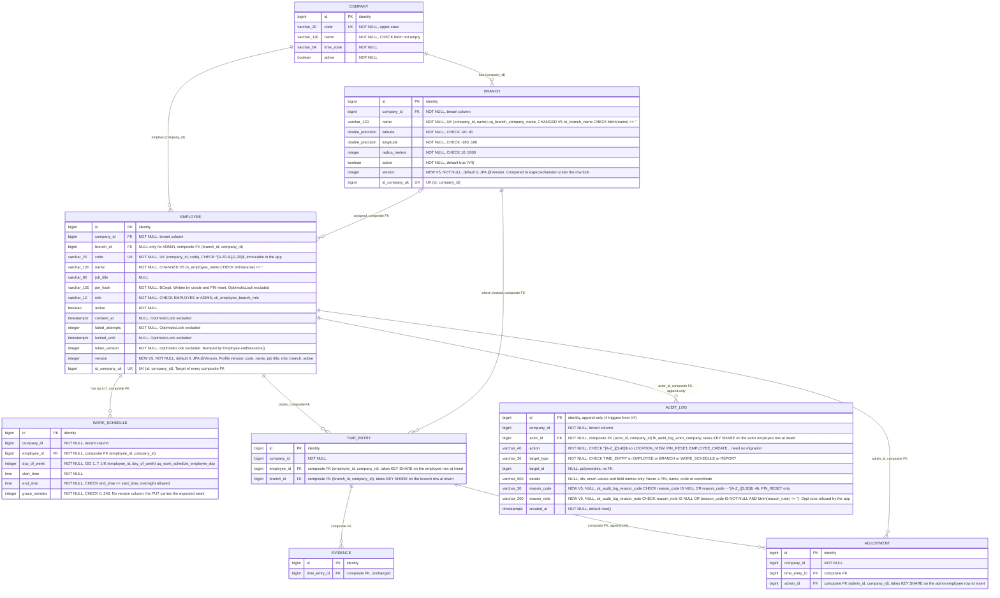
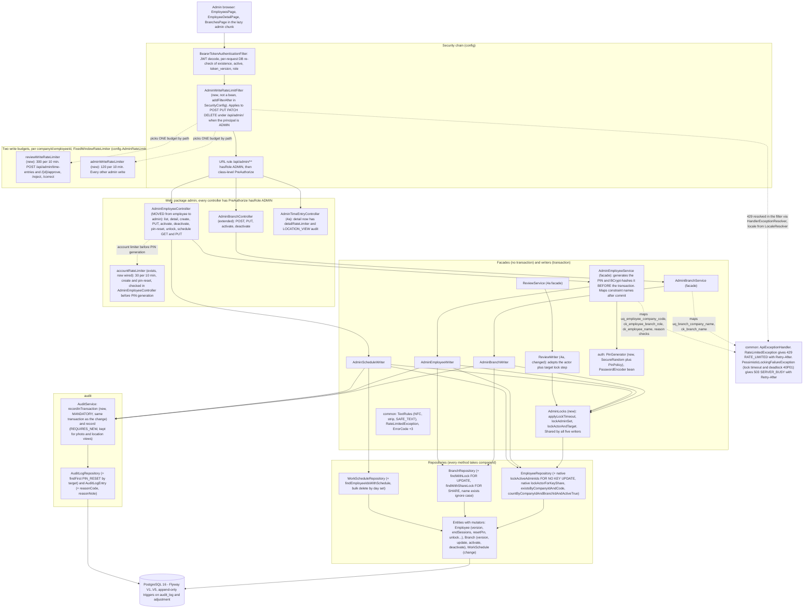
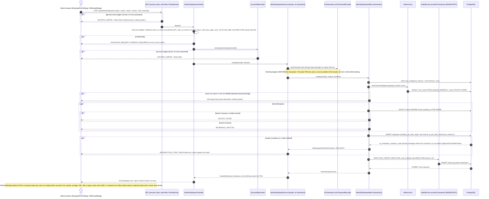
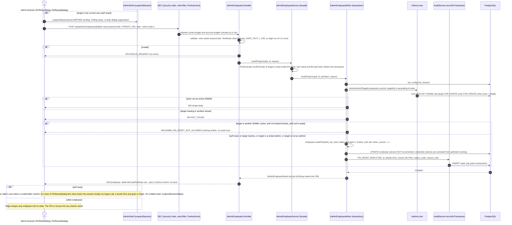
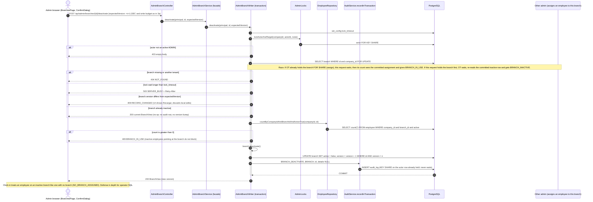
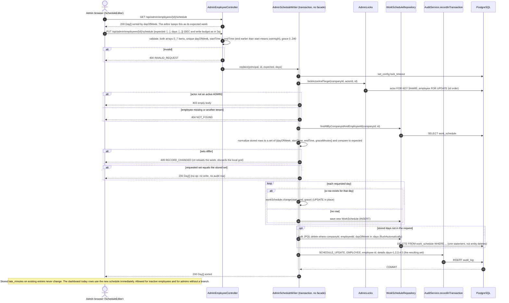
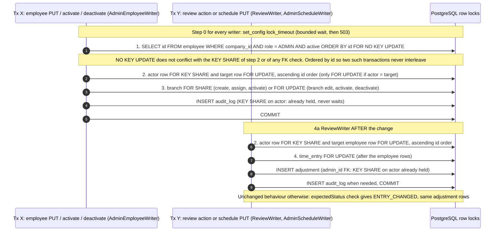

# Stage 4b - Management diagrams (branches, employees, schedules)

Source: `docs/plans/stage-4b-management.md` (REVISED 2026-11-03, open questions resolved by the user), checked against the live code at `20fcb94` (`V1`..`V4`, `cr.attendance.admin.ReviewWriter`, `timeentry.TimeEntryRateLimitFilter`, `config.SecurityConfig`, `common.ApiExceptionHandler`, `employee.EmployeeRepository`). Everything marked (new) does not exist yet and is drawn from the plan. This is a delta: the base diagrams are in `stage-4-admin-panel.md` (ER after V4, package layers, review sequences). Where the two differ, this file wins for 4b.

PII rule (CLAUDE.md, plan D14): the examples below use placeholders such as `<code>`, `<name>`, `<pin>`, `<lat>`. No real PIN, employee code, name or coordinate appears.

Contents:
1. ER diagram after V5
2. Layer diagram: 4b admin management packages
3. Sequences: (a) create employee with one-time PIN reveal, (b) PIN reset with optional reason, (c) branch deactivate, (d) schedule PUT with expected-week check, (e) lock order and the 4a `ReviewWriter` change, (f) deadlock to 503
4. Notes for the coder

---

## 1. ER diagram after V5

V5 (`V5__management_versions.sql`) changes four things: `version` on `employee` and `branch`, the blank-name checks `ck_employee_name` and `ck_branch_name`, and two nullable columns on `audit_log` with their checks. V1-V4 stay untouched. Columns tagged `NEW V5` are added by the migration. `time_entry`, `evidence` and `adjustment` are unchanged since V4 and are drawn with key columns only (full columns: `stage-4-admin-panel.md`). `id_company_uk` is a drawing device for `UNIQUE (id, company_id)`. `version` is mapped as JPA `@Version`; the credential, lock and consent columns of `employee` are `@OptimisticLock(excluded = true)`, so a PIN reset or a login never changes `version`.



What V5 does:

| # | Statement | Effect |
|---|---|---|
| 1 | `ALTER TABLE employee ADD COLUMN version integer NOT NULL DEFAULT 0` | Existing rows start at 0 |
| 2 | `ALTER TABLE branch ADD COLUMN version integer NOT NULL DEFAULT 0` | Same |
| 3 | `ck_employee_name`, `ck_branch_name` | Blank names refused by the database too (the coder greps test SQL for blank names first) |
| 4 | `audit_log ADD COLUMN reason_code`, `reason_note` (nullable, no default) | No row rewrite; the append-only triggers fire on UPDATE/DELETE/TRUNCATE only, so `ALTER` is not blocked |
| 5 | `ck_audit_log_reason_code`, `ck_audit_log_reason_note` | Format check (the Java enum `PinResetReason` is the allow-list); a note needs a code |

Counts for `SchemaEnglishNamingTest`: u/c/f constraints 51 -> 55, `ix_` indexes unchanged at 9. `SchemaMigrationTest` expects version `5`.

Important: there is an FK-driven row lock that the lock order (section 3e) depends on. Every insert into `audit_log` (actor), `adjustment` (admin), `time_entry` (employee and branch) takes `FOR KEY SHARE` on the referenced row. That lock conflicts with `FOR UPDATE` on the same row, which is why the plan locks the actor row first.

---

## 2. Layer diagram: 4b admin management

Arrows point from the depending component to the one it uses. Solid arrows are calls or compile-time dependencies. Dashed arrows are injected beans or filter registration. The pattern is the 4a `ReviewService` / `ReviewWriter` split: a non-transactional facade maps constraint violations after the transaction ends, and a transactional writer takes the locks. `AdminScheduleWriter` has no facade (no unique conflict is expected under the employee lock).



Dependency rules shown:

| Rule | Detail |
|---|---|
| `admin -> auth` | Only `PinGenerator`, `PinPolicy` and the `PasswordEncoder` bean. `auth` never imports `admin`. This is why `AdminEmployeeController` moves from `employee` to `admin`: `employee -> auth` would be a cycle. |
| `admin -> audit`, `company`, `employee`, `timeentry` | As in 4a. `employee` gains no new dependency; `EmployeeQueryService` and `EmployeeSummary` are deleted. |
| `common` | `TextRules`, `RateLimitedException`, 3 new `ErrorCode`s, `AuditAction.LOCATION_VIEW`. Still imports no feature package. |
| `config` | `AdminWriteRateLimitFilter` is registered in `SecurityConfig` like `TimeEntryRateLimitFilter` (live class lives in `timeentry`, `config` already depends on `timeentry`). New limiter beans in `AdminRateLimits`. |
| Budget choice | One budget per request, by path. A review action never consumes the general budget and vice versa. Every attempt counts. A create or PIN reset also counts against the account limiter. |
| Transactions | Writers are `@Transactional`. Facades are not. Audit rows are written with `MANDATORY` propagation inside the writer transaction. A `REQUIRES_NEW` insert whose `actor_id` FK points at a row the outer transaction holds `FOR UPDATE` would wait on its own caller. |

---

## 3. Sequence diagrams

Common to all admin endpoints: the request passes the Stage 1 security chain, then the write-rate-limit filter (new), then the URL rule and `@PreAuthorize`. Drawn once as `SEC` below and not repeated. A missing or stale token is 401. A non-admin is an empty 403 and is not counted by the write limiter. `companyId` and the actor come only from `EmployeePrincipal`.

### 3a. Create employee with one-time PIN reveal

`POST /api/admin/employees` `{code: <code>, name: <name>, jobTitle?, role, branchId?}`. The PIN is generated and hashed before any lock is held, returned once in the 201 response with `Cache-Control: no-store`, and appears nowhere else: not in the audit row, logs, errors or the view.



Key rules shown:
- **The one allowed PIN path.** `201 create` and `200 pin-reset`, both `no-store`, to the requesting admin.
- **Hash before lock, check actor after hash.** The actor is re-read inside the transaction, so a demotion during hashing still gives 403.
- **Constraint mapping is by name after the transaction.** The unique violation is mapped by the facade, never inside the writer.
- **Failed create returns no PIN** (the generated PIN is discarded).

### 3b. PIN reset with optional reason

`POST /api/admin/employees/{id}/pin-reset` with no body, `{}`, or `{reasonCode?, note?}`. Reason code is one of `FORGOT_PIN`, `ACCOUNT_LOCKED`, `POSSIBLE_MISUSE`, `OTHER`. A note without a code is 400. The note refuses 4 or more digits (separators allowed) so a PIN, an id number or a phone cannot be stored in it. The reset also clears the lock and bumps `token_version`.



Decision table for the target:

| Target | Actor = target | Result |
|---|---|---|
| Any role, self | yes | Allowed (UI warns, session ends) |
| EMPLOYEE (active, inactive, locked) | no | Allowed |
| ADMIN, inactive | no | Allowed (prepares a re-activation) |
| ADMIN, active, locked | no | Allowed (the Stage 1 lockout case) |
| ADMIN, active, not locked | no | 409 `ADMIN_PIN_RESET_NOT_ALLOWED` |

Unlock of another admin stays allowed in all cases (it only clears a lock).

### 3c. Branch deactivate

`POST /api/admin/branches/{id}/deactivate` `{expectedVersion}`. The branch is locked `FOR UPDATE`; the employee count runs as a new statement after the lock, so it sees every committed assignment. Invariant: no active employee is ever assigned to an inactive branch.



Key rules shown:
- **Branch writes take the branch last.** The actor `KEY SHARE` is taken first, so the later audit FK check never waits on the same transaction's own earlier lock or on another admin.
- **Edit and activate** use the same shape (branch `FOR UPDATE`, version compare, name precheck case-insensitive plus `uq_branch_company_name` as backstop, no-op returns 200 without audit).
- **Create** takes only the actor lock; there is no existing branch row.

### 3d. Schedule PUT with expected-week check

`PUT /api/admin/employees/{id}/schedule` `{expected: Day[], days: Day[]}`. A `Day` is `{dayOfWeek 1..7, startTime "HH:mm", endTime "HH:mm", graceMinutes 0..240}`. There is no version column; the writer locks the employee row and compares the stored week to `expected`. Rows are updated in place so Hibernate's flush order (inserts, updates, then entity deletes last) cannot break `uq_work_schedule_employee_day`.



Key rules shown:
- **Why not delete-then-insert.** Replacing Monday 08:00 with Monday 09:00 as a delete plus insert would violate the unique key because Hibernate runs entity deletes last. A regression test covers it.
- **Optimistic check under a pessimistic lock**, the 4a pattern, with the loaded week as the version.
- **Audit target is `EMPLOYEE`**, not `WORK_SCHEDULE` (so "everything done to employee X" is one query).

### 3e. Revised lock order, including the 4a ReviewWriter change

Every management writer and `ReviewWriter` take locks in this one order, never the reverse: (1) company admin set `FOR NO KEY UPDATE`, only for employee PUT, activate and deactivate; (2) actor row `FOR KEY SHARE` together with the target employee row `FOR UPDATE`, in ascending id order; (3) branch (`FOR SHARE` for assign, create-employee and activate; `FOR UPDATE` for branch edit, activate and deactivate); (4) the time entry (`ReviewWriter` only). The actor row is locked first because every `audit_log`, `adjustment` and `time_entry` insert takes `KEY SHARE` on the row it references.

Live 4a code today (`ReviewWriter.lockEntry`, line 208): reads the entry's employee id without a lock, then `employee FOR UPDATE`, then `time_entry FOR UPDATE`. The actor row is not locked, and the `adjustment.admin_id` FK check at insert (line 231) needs `KEY SHARE` on the actor. Two admins acting on each other's entries form a cycle today. `create` (line 157) locks only the target employee, same gap.



Why the actor goes first, as a table of the cycles the old order allowed:

| Cycle | Before | After |
|---|---|---|
| Branch deactivate vs assigning the actor to that branch | Deactivate holds branch `FOR UPDATE`, then audit FK needs `KEY SHARE` on actor A. The assign holds A `FOR UPDATE`, then branch `FOR SHARE`. | Deactivate takes actor A `KEY SHARE` before the branch; the assign's `FOR UPDATE` on A waits at step 2, before it takes the branch. |
| Admin edits a branch while their own PWA clock-in runs | Branch `FOR UPDATE`, then actor needed by the audit FK. PWA POST holds the same employee `FOR UPDATE`, then `time_entry` FK `KEY SHARE` on the branch. | The branch writer waits at step 2, before it takes the branch. |
| Two admins reset, unlock or edit schedules of each other | Each holds the other's row `FOR UPDATE` and needs `KEY SHARE` on its own for the audit/adjustment FK. | Both take actor and target in id order; the actor `KEY SHARE` is held before any wait. |

Resulting rule: no transaction takes an employee row after a branch lock. Known and accepted: a branch edit or deactivate (`FOR UPDATE`) briefly delays clock-ins at that branch because of the `time_entry` FK check.

### 3f. Residual deadlock to 503

Paths not covered by the order (a future writer that breaks it, operator SQL, lock upgrade, see the notes) end in PostgreSQL SQLSTATE `40P01`. One transaction is aborted. Spring translates it to `CannotAcquireLockException`, a `PessimisticLockingFailureException`, which the existing `ApiExceptionHandler.lockTimeout` (line 87) already maps. A `lock_timeout` expiry (SQLSTATE `55P03`) takes the same route.

```mermaid
sequenceDiagram
    autonumber
    actor A1 as Admin browser 1
    actor A2 as Admin browser 2
    participant W1 as Writer transaction 1
    participant W2 as Writer transaction 2
    participant DB as PostgreSQL
    participant SV as Facade (no transaction)
    participant EX as ApiExceptionHandler

    A1->>W1: write request
    A2->>W2: write request
    W1->>DB: lock row P
    W2->>DB: lock row Q
    W1->>DB: lock row Q (waits)
    W2->>DB: lock row P (waits)
    Note over DB: deadlock_timeout elapsed, cycle detected
    DB-->>W2: ERROR 40P01 deadlock detected, W2 aborted and rolled back
    DB-->>W1: lock Q granted after W2 rollback
    W2-->>SV: CannotAcquireLockException (translated by Spring)
    Note over SV: Facade catches DataIntegrityViolationException only. The lock exception is NOT mapped to a 4xx and not logged with the SQL detail.
    SV-->>EX: PessimisticLockingFailureException
    EX-->>A2: 503 SERVER_BUSY + Retry-After (fixed localized text, no code, name or PIN)
    W1->>DB: INSERT audit_log, COMMIT
    W1-->>A1: normal 2xx
    Note over A2: A2 never received a PIN (create and reset generate it before the transaction and discard it). The user may retry; create is not idempotent, so the UI shows createUncertain only for network errors, not for 503.
```

Key rules shown:
- **Never 500.** A test (`ManagementLockOrderIntegrationTest`) asserts 503 for both the lock timeout and the deadlock.
- **The survivor commits normally.** PostgreSQL aborts exactly one participant.
- **No PII in the failure path.** `logServerErrorDetail=false` on the driver and `SqlExceptionHelper` logging off keep row values out of logs.

---

## 4. Notes for the coder

Ambiguities and risks the diagrams reveal; the plan does not settle them.

1. **Actor check order is stated twice differently.** D3 says the actor re-check is "the first check after the locks" for every writer (before the target 404), but the D3 numbered list puts it at position 6 (after 404, version, validation, self, last admin). Decide: all writers do a first check from the `lockActorForKeyShare` projection (active and ADMIN, else empty 403); the three privilege writers additionally check membership in the locked admin set at step 6. The diagrams draw the early check. Keep the plan's intent that a demoted admin learns nothing about other rows.
2. **Actor equals target.** Step 2 then takes only `FOR UPDATE` on the entity, so the actor check must read `role` and `active` from the loaded `Employee`, not from the key-share projection. Write the helper so both paths return the same type, and cover self PIN reset and self schedule edit in tests.
3. **Possible residual cycle through the `NO KEY UPDATE` to `FOR UPDATE` upgrade.** The admin-set lock takes `FOR NO KEY UPDATE` on every active admin (step 1), then the target admin is locked `FOR UPDATE` (step 2, an upgrade). Another transaction that holds `KEY SHARE` on that target as its actor and then wants a row this one holds (for example the review of an entry of an admin the first transaction already holds) can cycle with it, and the key-share holder never took step 1. Not covered by the order; it falls into the 503 path (3f). Either document it as accepted or make the review and schedule writers take step 2 in the same id order as step 1 for admins (they already do for actor and target). Add it to the lock-order test list.
4. **Hash before knowing the request is refused.** The PIN reset hashes (about 250 ms) before the transaction, so `ADMIN_PIN_RESET_NOT_ALLOWED`, 403 and 404 all waste a BCrypt hash, and the reset also needs the target code for `nextPin(code)` before the target is locked. The plan does not say where the code comes from. Suggest an unlocked pre-read of the target (code, role, active) in the facade only to pick the code; the writer re-validates under the lock and must not trust it. Do not use the pre-read to skip any check in the writer.
5. **503 must not be swallowed by the facade.** The facade catches `DataIntegrityViolationException` for constraint mapping. `CannotAcquireLockException` and a lock timeout are not integrity violations, but make sure the facade's catch does not widen to `DataAccessException`, and that it logs `constraint=` and the exception class only, never the message.
6. **Where the schedule `expected` comparison is normalized.** `time` columns come back with seconds (`08:00:00`), requests use `HH:mm`. Compare as `LocalTime` truncated to minutes, and sort by `dayOfWeek`. A mismatch in format would give a false `RECORD_CHANGED` on every save. The schedule GET must return `HH:mm`.
7. **`version` and the bulk updates.** `PIN reset` and `unlock` change only excluded columns, so Hibernate issues the UPDATE but does not increment `version`, which is intended. Assert in a test that a PIN reset between a form's load and its save does not give `RECORD_CHANGED`, while a name change does. The employee `deactivate` must change `active` (a versioned column) so `version` moves; do not implement it with an excluded-only change.
8. **No-op detection and `version`.** Several no-ops return 200 without audit or version bump (already inactive, same schedule, unlock with nothing to clear). The mutators must return "changed" so the writer can skip the audit row; make the `Branch.update` and `Employee.updateProfile` change detection compare normalized (cleaned) values, otherwise a pure whitespace difference writes an audit row.
9. **Rate-limit filter placement.** The plan says `config/AdminWriteRateLimitFilter`; the live in-chain filter pattern is `timeentry.TimeEntryRateLimitFilter`, registered with `addFilterAfter(BearerTokenAuthenticationFilter)` in `SecurityConfig`. The new filter must run before `AuthorizationFilter` (so before the URL rule, binding and validation), count only when the principal's role is ADMIN, and resolve the locale itself (the dispatcher has not run). An EMPLOYEE token on an admin write is not counted and still gets the empty 403.
10. **Path matching for the review budget.** `POST /api/admin/time-entries` and `/{id}/approve|reject|correct` use the review budget; `{id}` must be a numeric segment. Use exact matching, and decide behaviour for a trailing slash or a path with `;jsessionid` style parameters (Spring Security normalizes some of these; test that the general budget cannot be used to bypass the review one or vice versa).
11. **Account limiter versus write limiter.** A create or PIN reset counts against both. The write filter answers first; the account limiter is checked in the controller before PIN generation. Both answer `RATE_LIMITED`. The sequence shows the write budget first; confirm no code path hashes a PIN before the account limiter passes.
12. **Unlock of another admin and last-admin guard.** Unlock takes the actor and target locks but not the admin set. It does not change role or active, so this is fine, but the plan's guard list (D3) does not state which guards apply to unlock and schedule PUT: only actor check, 404 and (schedule) `RECORD_CHANGED`. Keep it that way and test it.
13. **Self-reset client flow versus the audit and `lastPinReset`.** After a self reset the response includes `lastPinReset` for the caller, but the caller is leaving. Skip the merge into page state for the self case and clear the session; do not call logout.
14. **`ReviewWriter.create` path.** It locks the target employee without a prior entry lookup. Under the new order add the actor `KEY SHARE` step there too, not only in `lockEntry`. Both methods need the same helper call.
15. **`AuditService.recordInTransaction` is `MANDATORY`.** A writer that calls it outside a transaction throws `IllegalTransactionStateException` (a 500). Unit tests that call the writer directly need a transaction. The photo and location paths keep the `REQUIRES_NEW` `record`.
16. **PII in test names and fixtures.** Use placeholders in tests, DTO examples, README and logs (`<code>`, `<name>`). Tests assert on PIN validity and login, and never print the PIN value, including in assertion messages.
